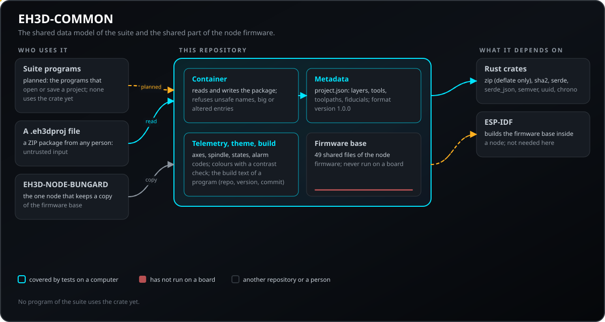
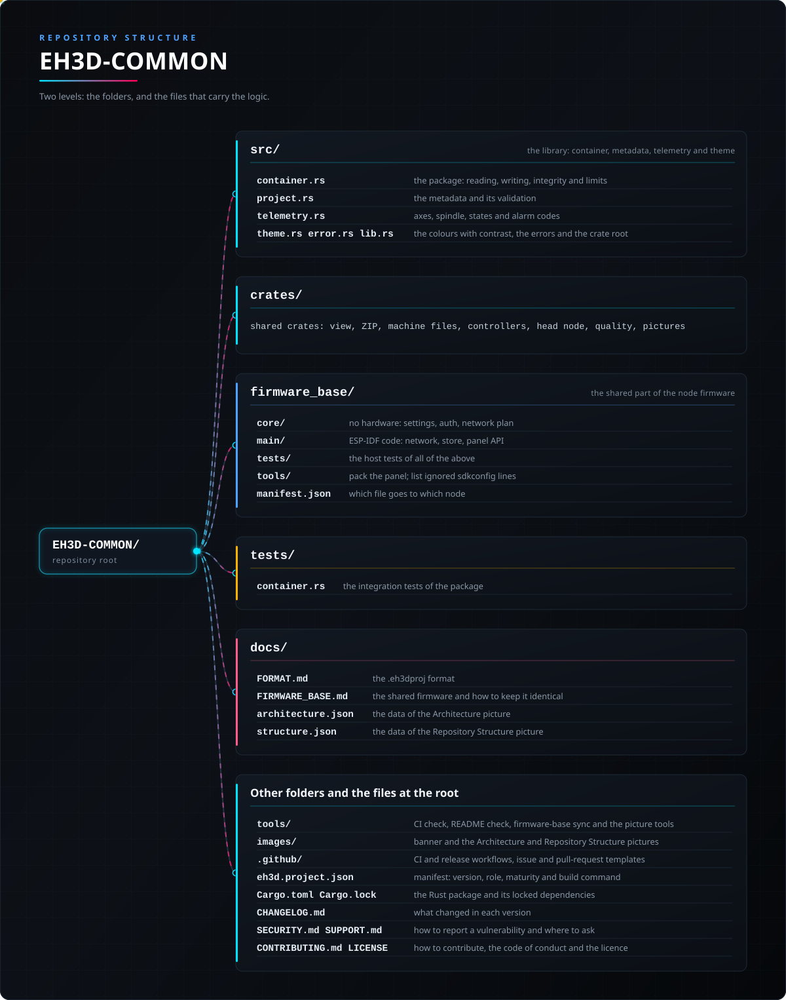

<p align="center">
  
</p>

# 🧱 EH3D-COMMON

<p align="center"><a href="README.md">🇺🇸 English</a> | <a href="README_spa.md">🇪🇸 Español</a> | <a href="README_fra.md">🇫🇷 Français</a> | 🇮🇹 <b>Italiano</b> | <a href="README_deu.md">🇩🇪 Deutsch</a> | <a href="README_zho.md">🇨🇳 中文</a> | <a href="README_jpn.md">🇯🇵 日本語</a> | <a href="README_por.md">🇵🇹 Português</a></p>

### Il modello di dati condiviso della EH3D Fabrication Suite: contenitore di progetto, metadati, controlli di integrità e telemetria macchina

<p align="center">
  
  
  
  
  
</p>

---

**Verifica di onestà - cosa funziona oggi:** una libreria Rust con il contenitore di progetto (`.eh3dproj`), i metadati di un progetto, i controlli di integrità SHA-256, i tipi di telemetria macchina e i colori della suite, più la base del firmware che ogni nodo ESP32 della suite copia (95 file e lo strumento che mantiene le copie identiche). 1215 test girano su un computer. I programmi di foratura e fresatura e l'interfaccia moderna leggono i loro file e disegnano i loro lavori con i crate condivisi; nulla di qui è stato eseguito su una macchina o su una scheda.

---

> **Stato di sicurezza funzionale e informatica:** questa libreria non è un sistema di sicurezza funzionale e nessuna macchina è stata controllata con essa. Il contenitore rileva un pacchetto danneggiato o alterato per errore, ma non è firmato né cifrato: non prova chi ha scritto un progetto. Un pacchetto di un'altra persona è un input non fidato, per questo nomi, dimensioni e numero delle voci sono limitati.

## 📋 In breve

| | |
|---|---|
| Versione | `0.3.8` |
| Maturità | Impalcatura |
| Test | 1215 |
| Stack tecnologico | Rust (crate di libreria) e C++17 (base del firmware) |
| Su hardware reale | Non applicabile: una libreria di dati, nulla qui parla con una macchina; la base del firmware non è mai stata eseguita su una scheda |

**Vai a:** [Panoramica](#-panoramica) · [Architettura](#-architettura) · [Avvio rapido](#-avvio-rapido) · [Test](#-test) · [Struttura](#-struttura-del-repository) · [Correlati](#-progetti-correlati)

## 🚦 Stato del progetto

Ogni riga è una parte di questo repository e il semaforo dice a che punto è oggi. È scritta in base a ciò che il repository può mostrare (test, compilazioni, esecuzioni), non a ciò che è previsto.

🟢 Fatto e verificato · 🟡 Funziona, con limiti noti · 🟠 Fatto a metà o non ancora verificato · 🔴 Non fatto o non funzionante

| Area | Stato | Cosa significa qui |
|---|---|---|
| Contenitore | 🟡 | `.eh3dproj` è uno ZIP standard con un registro SHA-256 di ogni voce; legge, scrive e rifiuta voci danneggiate, alterate, non elencate o non sicure. Finora lo leggono e scrivono solo i suoi test. |
| Metadati | 🟡 | I metadati di un progetto (unità, zero, livelli, utensili, percorsi, fiduciali) sono convalidati e portano una versione di formato semantica; non c'è ancora migrazione perché 1.0.0 è il primo formato. |
| Telemetria e tema | 🟡 | Assi, mandrino, stati della macchina, codici di allarme GRBL con la loro gravità e colori della suite con controllo del contrasto, tutto testato. |
| Test | 🟡 | Passano 1215 test (`cargo test --workspace`): 26 nei moduli e 33 sul contenitore del crate principale, e 1156 nei ventidue crate condivisi. |
| Sicurezza | 🟡 | Nomi non sicuri, voci troppo grandi o troppo numerose e qualsiasi voce alterata vengono rifiutati; il pacchetto non è firmato né cifrato e non ha avuto una revisione indipendente. |
| Base del firmware | 🟠 | 95 file mantenuti identici da `tools/sync_firmware_base.py`: 50 condivisi dai nodi ESP32 EH3D-NODE-BUNGARD ed EH3D-NODE-BUNGARD-AUX (48 di essi da entrambi; provati solo su un computer, con i test host di quei due nodi) e 45 condivisi dai due schermi tattili EH3D-NODE-BUNGARD-HMI e EH3D-NODE-HMI-GUI; mai eseguita su una scheda. |
| Uso da altri programmi | 🟡 | I crate del workspace sono usati da EH3D-DRILLPRO, EH3D-ROUTEPRO, EH3D-BUNGARD-GUI, EH3D-PHOENIX-CNC ed EH3D-SERVER (per percorso, con i repository affiancati); il contenitore di progetto in sé non è ancora usato da alcun programma. |
| Documentazione | 🟡 | README in otto lingue, la descrizione del formato e la guida alla base del firmware; la CI le confronta con il manifesto e il registro delle modifiche. |

## 🎯 Panoramica

* Il **contenitore di progetto**: un pacchetto `.eh3dproj` è un archivio ZIP standard con `project.json`, `integrity.json` e le cartelle `layers/`, `toolpaths/` e `vision/`. La scrittura è deterministica (lo stesso contenuto dà gli stessi byte) e passa per un file temporaneo.
* I **metadati** di un progetto: nome, identità, unità, zero del pezzo, livelli, utensili, percorsi e fiduciali, con una versione di formato semantica (oggi 1.0.0). Una versione maggiore più nuova viene rifiutata invece di essere capita a metà; una più vecchia richiede una migrazione registrata, e non ne esiste ancora nessuna.
* Il **registro di integrità**: lo SHA-256 e la dimensione di ogni voce. Un pacchetto con una voce cambiata, mancante o non elencata non si apre.
* I **limiti**: i nomi di voce che potrebbero uscire dalla cartella del pacchetto vengono rifiutati, così come le voci troppo grandi o troppo numerose.
* I **tipi di telemetria**: assi, mandrino, stati della macchina letti dalle parole di stato e i nove codici di allarme GRBL con la loro gravità (avviso o critico; un codice sconosciuto conta come critico).
* Il **testo di build**: quale build di un programma è in esecuzione (repository, versione, commit e tipo) come piccolo JSON che il binario porta, con un lettore rigoroso e i codici da `EH3D-BUILD-001` a `EH3D-BUILD-008` ([docs/BUILD.md](docs/BUILD.md)).
* Il **tema**: i colori della suite, con un controllo del contrasto WCAG che i test applicano a ogni colore di testo e di stato.
* La **base del firmware dei nodi** (`firmware_base/`, con `tools/sync_firmware_base.py`): la parte del firmware dei nodi ESP32 che ogni nodo EH3D condivide - il documento delle impostazioni, la rete, il server del pannello, utenti e sessioni, l'aggiornamento con ripristino, il registro, l'autoprotezione e i test relativi - scritta una volta con il nome del progetto come segnaposto. Ogni nodo tiene la propria copia e si compila da solo; lo strumento scrive la base in ogni nodo e segnala quando una copia si è discostata.
* I **crate condivisi** del workspace: `eh3d-view` (il lavoro sul piano, undici temi, le parole dell'interfaccia in otto lingue), `eh3d-archive` (lavori in archivi ZIP), `eh3d-bungard-formats` (i file Excellon, HP-GL, tabelle utensili e configurazione, i contorni Gerber e DXF), `eh3d-controller` (l'interfaccia dei controllori di macchina, GRBL, Marlin e Klipper, di cui si può leggere la corsa massima, e le macchine simulate su cui vengono provati, con un cavo che rovina i messaggi secondo un seme), `eh3d-filedialog` (le finestre Apri e Salva) e `eh3d-fleet` (le macchine e stazioni del server) e `eh3d-serverclient` (l'unico client del server: accesso e rinnovo, gli errori per codice in otto lingue, i tentativi ripetuti, lo stato del collegamento, una coda per le richieste che attendono mentre il server è assente, la cache del contratto che nota le rotte ritirate, le metriche del collegamento, le intestazioni e i corpi in byte con la regola del tag dell'archivio dei progetti (`ETag`, `If-Match`, i rifiuti 428 e 412) e una ricerca mDNS facoltativa, spenta per impostazione predefinita; il pannello delle sue impostazioni, l'elenco delle sessioni e l'indicatore del collegamento sono in `eh3d-view`), e `eh3d-dock` (la cornice delle finestre professionali: pannelli che si agganciano, fluttuano, si ripiegano e si bloccano, aree di lavoro con nome, una barra dei menu dichiarata come dati e scorciatoie da tastiera, in otto lingue; il disegno con egui è la funzionalità `gui`; guida in [docs/DOCKING.md](docs/DOCKING.md)). Con esso un programma della famiglia PHOENIX mette il suo colore sugli accenti della sua finestra e tiene i progetti recenti nella cartella dell'utente.
* **Le viste standard della macchina:** `eh3d_view::views` disegna il piano e il volume della macchina dall'alto (una vera pianta: X a destra, Y in alto, l'altezza non sposta il punto), di fronte (X a destra, Z in alto), di lato (Y a destra, Z in alto) e nella consueta vista isometrica, tutte con la stessa scala sui due assi dello schermo, e adatta ciascuna a una scatola della macchina in un'area di pixel con un margine. La proiezione di `Iso` non cambia.
* **L'altezza del tavolo e il nodo della testa di foratura:** `eh3d-levelling` conserva la mappa delle altezze del tavolo di una macchina (una griglia di punti misurati, la superficie tra loro per interpolazione, l'inclinazione e la differenza, la correzione della Z di un lavoro e una forma di testo per conservare la mappa), e `eh3d-aux` è il client di EH3D-NODE-BUNGARD-AUX (il suo stato, la sua misura del tavolo, la sua telecamera come MJPEG, le richieste con il token e un piccolo client HTTP).

## 🧩 Ruolo in EH3D

EH3D-COMMON è la base della suite. I crate del suo workspace (la vista e i temi, gli archivi ZIP, i file delle macchine Bungard, i controllori di macchina, le finestre dei file e la flotta del server) sono usati oggi da EH3D-DRILLPRO, EH3D-ROUTEPRO, EH3D-BUNGARD-GUI, EH3D-PHOENIX-CNC ed EH3D-SERVER; le librerie e i programmi che aprono o salvano un progetto dovranno dipendere dal contenitore, e nessuno esiste ancora. Anche la base del firmware dei nodi vive qui: EH3D-NODE-BUNGARD è il primo nodo che la usa.

## 🏛️ Architettura

<p align="center">
  
</p>

Come si incastrano le parti di questo repository: chi lo usa, che cosa contiene e da che cosa dipende. L'immagine è disegnata da `docs/architecture.json` e verificata rispetto al codice.

## ✨ Funzionalità

* **Scrittura deterministica e atomica:** lo stesso progetto dà sempre gli stessi byte e il file viene scritto tramite uno temporaneo, quindi una scrittura fallita non lascia un pacchetto a metà.
* **Tutto controllato in lettura:** prima nomi, numero e dimensioni, poi il registro di integrità contro ogni voce e infine i metadati; il primo problema ferma la lettura con un errore tipizzato.
* **Un formato che ogni strumento apre:** ZIP semplice (solo deflate) e JSON semplice, leggibili senza questo crate; `docs/FORMAT.md` è il contratto scritto.
* **I lettori restano compatibili:** la stessa versione maggiore viene letta ignorando ciò che non conosce; una versione maggiore più nuova viene rifiutata.
* **Codici di allarme che non si perdono:** un codice che questo crate non conosce resta come `Unknown(n)` e conta come critico.
* **Una base del firmware per tutti i nodi:** si modifica dove è nata l'esigenza, si fa `import`, si fa `sync` negli altri e il `check` della CI segnala quando una copia si discosta.
* **L'analizzatore di qualità e l'anello di LED della testa:** `eh3d-inspect` giudica una foto della telecamera della testa di foratura (fori presenti, rotondi, della misura giusta e al loro posto; canali fresati larghi quanto l'utensile, regolari e senza restringimenti; una foto abbastanza buona per giudicare) con un profilo di tolleranze, e dice conforme, non conforme o non valutabile. `eh3d-aux` accende e spegne anche l'anello di LED della telecamera, mostra a colori com'è andato un controllo, scatta una foto e consegna il profilo al server.
* **La diagnostica e il contenitore dei nuovi formati:** `eh3d-diagnostic` è il rilievo comune di ogni lettore (un codice stabile, una gravità, un messaggio, dove è successo, una forma JSON e una forma oscurata). `eh3d-container` contiene ciò che condividono tutti i contenitori di progetto: i parametri di un formato, il registro di integrità, il JSON canonico, la politica rigorosa di nomi e ZIP con i codici da `EH3D-PKG-001` a `EH3D-PKG-026`, un lettore in streaming con limiti, uno scrittore deterministico in streaming e la sostituzione atomica della destinazione (ritentata per un momento se un altro programma tiene il file su Windows). Il codice `.eh3dproj` 1.0.0 di questo crate non cambia. La cartella `crates/auxnode` è il pacchetto `eh3d-aux`.
* **Il contenitore di progetto a rami (`eh3d-project`):** un file `.eh3d` con un ramo per programma (`pcb/`, `cad/`, `3dp/`, `laser/`, `cnc/`, ...), `common/` con metadati facoltativi, `docs/` per la documentazione nelle otto lingue e `manufacturing/`, che contiene un pacchetto `.eh3dproj` 1.0.0 e lo restituisce byte per byte. Ogni programma scrive solo il proprio ramo e i byte degli altri non cambiano mai; un ramo derivato da un altro viene notato quando la sua origine è cambiata; un ramo sconosciuto viene conservato com'è. I codici da `EH3D-PKG-015` a `EH3D-PKG-026` sono suoi. I rami e l'intero progetto si possono firmare con Ed25519 (`ed25519-dalek`): le chiavi sono file esterni al progetto, mai stampate né salvate al suo interno, e all'apertura si dice per ogni firma se è presente e valida, assente o non valida. Il sigillo ha i suoi record e controlli; la cifratura di un ramo resta da fare (vedi `docs/adr/0002-eh3d-project-container.md`). Ciò che ogni programma fa con il proprio ramo (salvare, aprire, importare con rapporto, prendere da un altro ramo, avvisi di dati superati) è condiviso nel modulo `appbranch`. Il formato è in `docs/FORMAT_EH3D.md` e il comando `eh3d-project info|verify|extract-branch|keygen|protect-key|sign` guarda dentro un file. I programmi che producono qualcosa dal lavoro (visualizzatore, stencil, isolamento, foratura, fresatura) lo leggono e conservano il loro risultato con il modulo `manufacturing`, e le finestre condividono ciò che mostrano prima di scrivere (`suiteview`, con i testi nelle otto lingue in `suitetext`). Il salvataggio non comprime di nuovo ciò che non è cambiato (allegati compresi) e controlla ogni voce del nuovo file prima di sostituire il precedente. La scrittura sopra un progetto che un altro programma ha salvato dopo la lettura è rifiutata (`EH3D-PKG-025`), una firma viene sostituita solo con il consenso della persona (`EH3D-PKG-026`), una chiave segreta può essere protetta da una password (Argon2id e XChaCha20-Poly1305) e si ricorda solo il percorso della chiave usata (`docs/adr/0004-eh3d-safe-writes-and-keys.md`).
* **Allegati di un progetto:** qualsiasi file (schede tecniche, manuali, documenti d'ufficio, progetti e disegni, video, audio o altro) può viaggiare dentro il `.eh3d`, salvato una sola volta e collegato ai componenti del progetto che lo usano (sigla, valore o codice del costruttore), oppure solo come collegamento con indirizzo e hash. Programmi, script, documenti con macro, archivi compressi e pagine che possono eseguire codice sono segnati come pericolosi e si estraggono solo con il consenso di una persona; nulla viene eseguito o scaricato. Fino a 1 GB per allegato (configurabile), 4 GB per il progetto. Comandi `eh3d-project attach`, `attachments`, `extract-attachment` e `detach`; il formato è in `docs/FORMAT_EH3D.md` e `docs/adr/0003-eh3d-attachments.md`. Un programma li mostra con il pannello «Allegati» più sotto quando lo monta.
* **Il lettore di immagini:** `eh3d-image` legge i file PGM e PNG come livelli di grigio (grigio, colore, tavolozza o trasparente, 8 o 16 bit, con la trasparenza contata come bianco) con limiti di dimensione perché un file ostile non possa chiedere gigabyte, scala un'immagine con un filtro a scatola e vi disegna dei dischi. L'incisione laser e la ricerca dei fiduciali lo usano al posto di una copia ciascuno.
* **Il controllo prima che un lavoro parta:** `eh3d-summary` segue sulla carta i passi esatti di un piano (il bit di passo e quello di direzione di ogni asse, i finecorsa che inghiottono ciò che va oltre) per sapere fin dove arriva ogni asse e quanto dura il lavoro, trova il piano che esce dalla corsa della macchina prima che giri un motore, esegue i controlli di buon senso del lavoro (un'unità sbagliata, un lavoro più grande del piano o lontano dal suo angolo, una scala diversa da 1) con soglie che vengono dalla taratura della macchina, e dice tutto nelle otto lingue. Il programma di foratura, quello di fresatura, l'interfaccia moderna e il server mostrano lo stesso riepilogo.
* **Il database dei materiali delle schede:** `eh3d-materials` contiene laminati, prepreg, flex, nuclei metallici e schede in PTFE con i valori che ogni produttore pubblica (ogni record cita la sua scheda tecnica e un valore che la scheda non dà resta vuoto), li verifica al caricamento (identificatori unici, Dk, Df, Tg e Td credibili), risponde per identificatore, produttore, tipo e Tg, Dk e Df minimi, interpola Dk e Df tra le frequenze pubblicate senza mai estrapolare, fornisce la piccola vista di cui ha bisogno il programma della macchina e classifica i documenti di riferimento in base a ciò a cui servono (una CNC che fora e fresa schede, o lo strumento di progettazione). Una temperatura di transizione vetrosa che la scheda dà solo come limite («superiore a 280 C») è tenuta separata da quelle misurate. La stessa crate ha una seconda famiglia per i materiali che lavora una fresatrice CNC o un laser (55 legni, plastiche, metalli, materiali per circuiti, carta, cuoio, tessuto, gomma, schiuma e vetro, con i loro nomi in otto lingue): dice che cosa può fare un laser con ciascuno e perché no (PVC, ABS, policarbonato, vinile, fibra di carbonio e simili vengono rifiutati con il pericolo che c'è dietro) e dà punti di partenza per una fresatrice e un laser, interpolati tra punti noti, mai estrapolati e mai segnati come verificati; la guida è [docs/MACHINING.md](docs/MACHINING.md). I suoi errori hanno i codici da `EH3D-MAT-001` a `EH3D-MAT-015`.
* **Il database dei materiali di stampa 3D:** `eh3d-printmaterials` contiene filamenti FDM e resine fotopolimeriche (SLA, DLP, LCD, MSLA) con i valori che ogni produttore pubblica (ogni record cita la sua fonte, dice di non essere stato provato su una macchina e non ha prezzo), li verifica al caricamento, risponde per materiale, ugello, piatto, carica e stampante, indica il peso di un metro, l'essiccazione e l'ugello indurito che serve a un filamento, e l'esposizione di una resina per una stampante e un'altezza di strato, interpolata tra punti noti e mai estrapolata, con gli avvisi in otto lingue. La base iniziale di circa 475 filamenti proviene in parte da un database aperto con licenza MIT (l'avviso è nel crate). I suoi errori hanno i codici `EH3D-PMAT-001` – `EH3D-PMAT-009`; la guida è [docs/FILAMENTS.md](docs/FILAMENTS.md).
* **Il catalogo delle stampanti 3D:** `eh3d-printers` contiene, per ogni modello, il volume di stampa, gli ugelli, se è chiusa, le temperature massime, il sistema multicolore, la famiglia del programma che le parlerebbe e i file che accetta, ogni dato con la pagina pubblica del produttore e nessuno provato su una macchina (per ora le Bambu Lab A1, P1P e P1S, tre modelli Creality e due Artillery; ogni pagina dice quali dati sono stati letti su di essa e quali restano da controllare, e la velocità, l'accelerazione e la portata massime quando il produttore le pubblica). Fornisce filamenti di partenza dal database dei materiali, con i motivi contro quelli che la macchina non può stampare, e processi calcolati dall'ugello, in otto lingue; la guida è [docs/PRINTERS.md](docs/PRINTERS.md).
* **Il visualizzatore degli allegati:** `eh3d-viewer` mostra all’interno di un programma le schede tecniche, i manuali e gli altri file di un progetto: le pagine PDF con zoom e ricerca (PDFium senza motore di script, a una versione e un SHA-256 fissati, caricato solo dalla cartella del programma), le immagini, il testo, Markdown e il testo e le tabelle dei documenti da ufficio. Programmi, script, file con macro e archivi mostrano un avviso e chiedono conferma prima che qualcosa lasci il programma; un programma o uno script non viene mai avviato. Il pannello è la funzionalità `gui`, i testi sono in otto lingue e i programmi lo mostrano con il pannello degli allegati descritto sotto; la guida è [docs/VIEWER.md](docs/VIEWER.md).
* **Un’unica classificazione dei file e il pannello «Allegati»:** `eh3d-filekind` è l’unico posto che dice che cos’è un file allegato, se è pericoloso e quale nome può avere su un disco; programmi, script, file con macro, archivi compressi, HTML, SVG **e i tipi che la suite non conosce** chiedono conferma prima di essere estratti o aperti. `eh3d-attachpanel` è il pannello che un programma PHOENIX monta con poche righe: l’elenco del progetto, allegare un file o un collegamento, collegare a un componente, estrarre e rimuovere chiedendo prima, e il visualizzatore accanto, in otto lingue; un file di impostazioni che contiene il token del server non viene messo in un progetto. La guida è [docs/ATTACHMENTS_PANEL.md](docs/ATTACHMENTS_PANEL.md). Il pannello prende i suoi limiti dal file di impostazioni del programma (`attachments.max_mb`, `viewer.max_*_mb`), accoglie i file rilasciati su di esso e calcola lo SHA-256 di un file grande senza fermare la finestra.
* **Otto lingue:** le parole dell'interfaccia condivisa (`eh3d-view`) esistono in inglese, spagnolo, italiano, tedesco, francese, portoghese (del Portogallo), cinese e giapponese. Il codice `pt-br` è letto come portoghese e `fr-ca` come francese; il codice di qualsiasi altra lingua è sconosciuto e il programma tiene la lingua che aveva.

## 🔒 Sicurezza e protezione

Il contenitore legge file che altre persone possono inviare, quindi ogni controllo qui sotto è una difesa contro un pacchetto ostile o danneggiato, e ognuno ha il suo test.

| Minaccia | Difesa |
|---|---|
| Un nome che esce dalla cartella del pacchetto (`../x`, `/etc/x`, `C:\x`) | `check_entry_name` rifiuta un nome vuoto, assoluto o troppo lungo (oltre 240 byte), una barra rovesciata, i due punti, un carattere di controllo e qualsiasi parte vuota, `.` o `..`, in scrittura e di nuovo per ogni nome trovato in uno ZIP |
| Una zip bomb o un pacchetto con un numero enorme di voci | al massimo 10.000 voci, 256 MiB per voce e 1 GiB in totale; la lettura di una voce si ferma un byte oltre il suo limite |
| Una voce alterata per strada (per errore o di proposito) | lo SHA-256 e la dimensione di ogni voce vengono confrontati con `integrity.json`; una voce diversa, mancante o non elencata fa rifiutare l'intero pacchetto |
| Due voci con lo stesso nome | rifiutate come duplicato in lettura, e una voce sostituita in scrittura conserva una sola copia |
| Un pacchetto di un programma più nuovo | una versione maggiore di formato più nuova viene rifiutata invece di essere capita a metà |
| Metadati incoerenti (nome vuoto, id utensile ripetuto, NaN, diametro negativo, un livello fuori da `layers/`) | `validate` gira prima della scrittura e dopo la lettura; un progetto non valido non si può scrivere |
| Nessun codice unsafe | il crate è `#![forbid(unsafe_code)]` |

**Ciò che non è difeso:** il pacchetto non è firmato né cifrato. Chi può riscrivere le voci può riscrivere anche il registro di integrità, quindi rileva danni e incidenti, non un autore. La libreria non ha avuto una revisione indipendente. Segnala una vulnerabilità in privato (vedi [SECURITY.md](SECURITY.md)).

## 🔌 Interfacce

| Interfaccia | Che cos'è | Dove |
|---|---|---|
| API Rust | `Package` (`new`, `add_entry`, `entry`, `entry_names`, `integrity`, `write`, `write_to_path`, `to_bytes`, `read`, `read_from_path`), `ProjectMetadata` (`new`, `validate`, `to_json`, `read_metadata`), i tipi di telemetria e `theme`, `build` | `src/` |
| Formato di file | `.eh3dproj`: uno ZIP con `project.json`, `integrity.json` e le cartelle dati `layers/`, `toolpaths/` e `vision/` | [docs/FORMAT.md](docs/FORMAT.md) |
| Errori | un solo enum `Error`: `Io`, `Json`, `Zip`, `UnsupportedFormat`, `MissingEntry`, `Integrity`, `UnsafePath`, `DuplicateEntry`, `TooLarge`, `InvalidMetadata` | `src/error.rs` |
| Strumento della base del firmware | `python tools/sync_firmware_base.py check`, `sync`, `import <nodo>` e `status` | [docs/FIRMWARE_BASE.md](docs/FIRMWARE_BASE.md) |

Questo repository non ha programma a riga di comando, né server, né accesso alla rete.

## ⚙️ Configurazione

La libreria non ha un file di configurazione: i suoi limiti sono costanti del codice, elencate qui perché si sappia cosa può contenere un pacchetto. La versione del formato fa parte del file, non è un'impostazione.

| Valore | Limite | Dove |
|---|---|---|
| Voci in un pacchetto | da 1 a 10.000 | `MAX_ENTRIES` in `src/container.rs` |
| Dimensione di una voce | fino a 256 MiB (268.435.456 byte) | `MAX_ENTRY_BYTES` |
| Dimensione di tutte le voci insieme | fino a 1 GiB | `MAX_TOTAL_BYTES` |
| Lunghezza del nome di una voce | da 1 a 240 byte | `check_entry_name` |
| Cartelle dati | solo `layers/`, `toolpaths/`, `vision/` | `DATA_FOLDERS` in `src/project.rs` |
| Versione del formato | 1.0.0 (la stessa versione maggiore viene letta, una più nuova rifiutata) | `FORMAT_VERSION` |
| Diametro dell'utensile | finito e maggiore di 0 | `ProjectMetadata::validate` |

La base del firmware ha un proprio documento di impostazioni (`node_settings.hpp`, `config_common.hpp`); i suoi valori appartengono a ogni nodo e sono descritti nel README di EH3D-NODE-BUNGARD.

## 🚀 Avvio rapido

Serve una toolchain Rust stabile (1.89 o successiva).

```rust
use eh3d_common::{Package, ProjectMetadata};

fn main() -> eh3d_common::Result<()> {
    let mut package = Package::new(ProjectMetadata::new("Test board"));
    package.add_entry("layers/top.gbr", b"G04 test*".to_vec())?;
    package.write_to_path(std::path::Path::new("board.eh3dproj"))?;
    let again = Package::read_from_path(std::path::Path::new("board.eh3dproj"))?;   // controlla ogni voce
    println!("{} data entries", again.entry_names().count());
    Ok(())
}
```

```bash
cargo build --release
cargo test
cargo clippy --all-targets -- -D warnings
cargo fmt --check
python -I tools/ci_validate.py
python -I tools/sync_firmware_base.py check
```

## 🧪 Test

La suite ha 1215 test (`cargo test --workspace`, eseguiti su Windows e Linux nella CI): 26 nei moduli (i metadati e la loro validazione, i codici di allarme e gli stati della macchina, i colori e il loro contrasto WCAG, il testo di build (il formato, i rifiuti e i codici)) e 33 sul contenitore (14 di essi registrano il comportamento attuale del formato: ordine delle voci, JSON esatto, flag ZIP e verdetto su 19 pacchetti danneggiati; gli altri coprono andata e ritorno in memoria e su file, stessi byte per lo stesso contenuto, il registro di integrità, una voce cambiata, una dimensione cambiata, una voce non elencata, una voce mancante, metadati modificati, un file che non è un pacchetto, nomi di voce non sicuri e ostili, una voce sostituita e un progetto non valido, e un confronto della descrizione del formato con il codice). La CI esegue anche `cargo fmt --check` e `cargo clippy` con gli avvisi come errori, `python -I tools/ci_validate.py` (manifesto, versioni, registro delle modifiche e gli otto README) e `tools/sync_firmware_base.py check` (le copie della base del firmware). I test su computer della base del firmware (`firmware_base/tests/`) girano dentro EH3D-NODE-BUNGARD, non qui. I ventidue crate condivisi ne aggiungono 1156: gli archivi di lavoro (8), i file delle macchine Bungard, con archi, cerchi e scalatura HP-GL e i contorni Gerber e DXF, e il modo relativo e gli avvisi su un formato presunto o un comando non seguito (69), i controllori di macchina su una linea simulata (141) e la scena, le viste, i temi e le parole dell'interfaccia in otto lingue (87), le finestre Apri e Salva (7), le macchine e stazioni del server (8) e la mappa delle altezze del tavolo (11) il client del nodo della testa di foratura, con l'anello di LED e la foto (10), il lettore di immagini PGM e PNG (7), la simulazione a secco e il riepilogo prima di un lavoro (23) e l'analizzatore di qualità (43): i fori, i canali fresati, la qualità della foto, il profilo e il verdetto, e i pezzi condivisi dei formati di contenitore: il registro di integrità, l'hash del contenuto, la regola dei nomi e il JSON canonico, e il lettore e scrittore generici con la politica rigorosa, i codici `EH3D-PKG` e la sostituzione atomica (81), il contenitore di progetto `.eh3d` a rami: record, riferimenti, permessi, sigillo, firme, file danneggiati, allegati e riga di comando (112), e il client del server: accesso e rinnovo, i rifiuti per codice con il loro testo in otto lingue, i tentativi con pause crescenti, lo stato del collegamento e un token che non viene mai stampato (149) e la cornice a pannelli: la disposizione e le sue riparazioni, la geometria del trascinamento, la forma testuale e le aree di lavoro, le scorciatoie e i menu, le proposte di ogni settore e il disegno con egui (133). La diagnostica comune (6), il database dei materiali, per circuiti e per lavorazione (104) e quello dei materiali di stampa 3D (38) sono compresi nello stesso totale. Il catalogo delle stampanti 3D ne ha altri 26. Il visualizzatore degli allegati ne ha 63. La classificazione unica dei file ne ha 12 e il pannello degli allegati 18. Le funzionalità opzionali ne aggiungono 55, tutti eseguiti nella CI: il risolutore mDNS del client (170 test del client in tutto) e il disegno con egui della cornice a pannelli (157 in tutto), del visualizzatore (65) e del pannello degli allegati (22) e del pannello del server (91 test del crate delle viste in tutto); 4 test del visualizzatore usano la vera libreria PDF. Le cifre sono quelle della CI su Linux; altri 2 test sono marcati come ignorati e Windows ne esegue uno in meno.

## 🏗️ Compilazione e rilascio

La versione sta in `Cargo.toml` e in `eh3d.project.json`, e ogni versione ha la sua voce in [CHANGELOG.md](CHANGELOG.md). Le versioni vengono pubblicate su GitHub; la libreria si usa come crate Rust da questo repository e non è su crates.io.

## 📂 Struttura del repository

<p align="center">
  
</p>

<details>
<summary>Versione testuale dell'albero</summary>

```text
EH3D-COMMON/
├── src/
│   ├── container.rs                             il pacchetto: lettura, scrittura, integrità e limiti
│   ├── project.rs                               i metadati e la loro validazione
│   ├── telemetry.rs                             assi, mandrino, stati e codici di allarme
│   ├── build.rs                                 quale build è in esecuzione: repository, versione, commit e tipo, come piccolo JSON
│   └── theme.rs error.rs lib.rs                 i colori con contrasto, gli errori e la radice del crate
├── crates/                                      crate condivisi: vista, ZIP, file macchina, controllori, testa, qualità, immagini, riepilogo
├── firmware_base/
│   ├── core/                                    senza hardware: impostazioni, auth, piano di rete
│   ├── main/                                    codice ESP-IDF: rete, archivio, API del pannello
│   ├── tests/                                   i test su computer di tutto questo
│   ├── tools/                                   impacchetta il pannello; elenca le righe sdkconfig ignorate
│   └── manifest.json                            quale file va in quale nodo
├── tests/                                       il pacchetto: andata e ritorno, voci cambiate, mancanti e non elencate, nomi non sicuri
├── examples/                                    come usare il testo di build condiviso
├── docs/                                        il formato, la base del firmware e i dati delle due immagini
├── tools/                                       controllo della CI e del README, sincronizzazione della base del firmware e strumenti per le immagini
├── images/                                      banner e le immagini di Architettura e Struttura del repository
├── .github/                                     workflow di CI e di rilascio, modelli di issue e pull request
├── eh3d.project.json                            manifesto: versione, ruolo, maturità e comando di compilazione
├── Cargo.toml Cargo.lock                        il pacchetto Rust e le sue dipendenze bloccate
├── rust-toolchain.toml                          la toolchain Rust fissata
├── CHANGELOG.md                                 cosa è cambiato in ogni versione
├── SECURITY.md SUPPORT.md                       come segnalare una vulnerabilità e dove chiedere
└── CONTRIBUTING.md CODE_OF_CONDUCT.md LICENSE   come contribuire, codice di condotta e licenza
```

</details>

## 🗺️ Roadmap e limiti noti

**Limiti noti oggi**

* Nessun programma usa ancora il contenitore di progetto, quindi il formato è stato letto e scritto solo dai suoi test.
* Il pacchetto non è firmato né cifrato e la libreria non ha avuto una revisione indipendente.
* Non c'è migrazione, perché 1.0.0 è il primo formato.
* La base del firmware è stata esercitata solo tramite EH3D-NODE-BUNGARD e non è mai stata eseguita su una scheda; un secondo nodo non esiste ancora.
* La libreria non è pubblicata su crates.io.

**Prossimi passi**

* Far aprire e salvare un progetto con essa al primo programma della suite (prima EH3D-CORE-LIBS).
* Aggiungere il secondo nodo alla base del firmware e verificare che le copie restino identiche.
* Decidere se i pacchetti richiedono una firma facoltativa.

## 🌍 Lingue

Il README e i testi esistono in inglese, spagnolo, francese, italiano, tedesco, cinese, giapponese e portoghese europeo.

## 🔗 Progetti correlati

* [EH3D-CORE-LIBS](https://github.com/JuanenRac/EH3D-CORE-LIBS): i parser (Excellon, Gerber, G-code), le librerie di raster, geometria e CAM e gli scrittori Gerber ed Excellon
* [EH3D-NODE-BUNGARD](https://github.com/JuanenRac/EH3D-NODE-BUNGARD): il primo nodo che tiene una copia della base del firmware
* [EH3D-SERVER](https://github.com/JuanenRac/EH3D-SERVER): il centro della famiglia; usa i crate di riepilogo, ispezione e diagnostica di questo repository, non ancora il contenitore di progetto
* [EH3D-PHOENIX-PCB](https://github.com/JuanenRac/EH3D-PHOENIX-PCB): lo strumento di progettazione della famiglia, con i suoi fratelli [EH3D-VALIDATION-LAB](https://github.com/JuanenRac/EH3D-VALIDATION-LAB) ed [EH3D-PHOENIX-CAD](https://github.com/JuanenRac/EH3D-PHOENIX-CAD); costruisce il proprio formato di progetto su `eh3d-container` e segnala ogni errore con `eh3d-diagnostic`
* [EH3D-DOCS](https://github.com/JuanenRac/EH3D-DOCS): il centro di documentazione della suite e la sua mappa dei progetti
* [HYDRA-UMC](https://github.com/JuanenRac/HYDRA-UMC): la piattaforma di robotica le cui macchine la suite dovrà pilotare in futuro

## 📚 Documentazione

* [Formato di progetto](docs/FORMAT.md): le voci, i metadati, il registro di integrità e le regole per i lettori.
* [La base del firmware](docs/FIRMWARE_BASE.md): cosa è condiviso, come si mantiene identico e come aggiungere un nodo.
* [Registro delle modifiche](CHANGELOG.md)
* [Usare i crate](docs/CONSUMING.md): le cartelle sorelle, la riga di percorso e versione, le funzionalità e i tag con cui compila la CI.
* [Errori dei lettori di file](docs/FORMAT_ERRORS.md): i codici stabili, con riga e colonna, dei lettori del file di foratura, del tracciato e del disegno.
* [Il client del server](docs/SERVER_CLIENT.md): accesso e rinnovo, gli errori per codice in otto lingue, i tentativi ripetuti, lo stato del collegamento, le chiavi e il passaggio di ogni programma.
* [Il testo di build](docs/BUILD.md): il piccolo JSON che un programma porta per dire quale build è, come incorporarlo e i suoi codici.
* [I controllori di macchina](docs/CONTROLLERS.md): cosa viene pilotato (GRBL, Marlin, Klipper via HTTP), le macchine simulate e il cavo con guasti per provarli senza nulla di collegato, i numeri degli errori e come ciascuno ferma una macchina che tace.

## 🤝 Contribuire e comunità

* Prima di una pull request esegui `cargo fmt --check`, `cargo clippy --all-targets -- -D warnings`, `cargo test`, `python -I tools/ci_validate.py` e `python -I tools/sync_firmware_base.py check`: tutto deve passare. Vedi [CONTRIBUTING.md](CONTRIBUTING.md) e il [codice di condotta](CODE_OF_CONDUCT.md).
* Il README esiste in otto lingue: una modifica al testo si fa in tutti e otto i file, e le due immagini sono disegnate da `docs/architecture.json` e `docs/structure.json` con `tools/make_architecture.py` e `tools/make_structure.py`.
* Una modifica alla base del firmware si fa in un nodo, si importa con `tools/sync_firmware_base.py import` e si sincronizza negli altri; non modificare mai una copia a mano.
* Segnala una vulnerabilità in privato: [SECURITY.md](SECURITY.md). Domande, idee e segnalazioni: electrohobby3d@gmail.com ([SUPPORT.md](SUPPORT.md)).

## 👤 AUTORE

**JuanenRac (Electro Hobby 3D)** · electrohobby3d@gmail.com

## 📜 LICENZA

Software: GPL-3.0-or-later. Vedi [LICENSE](LICENSE). I progetti hardware della suite usano la CERN OHL-S.
