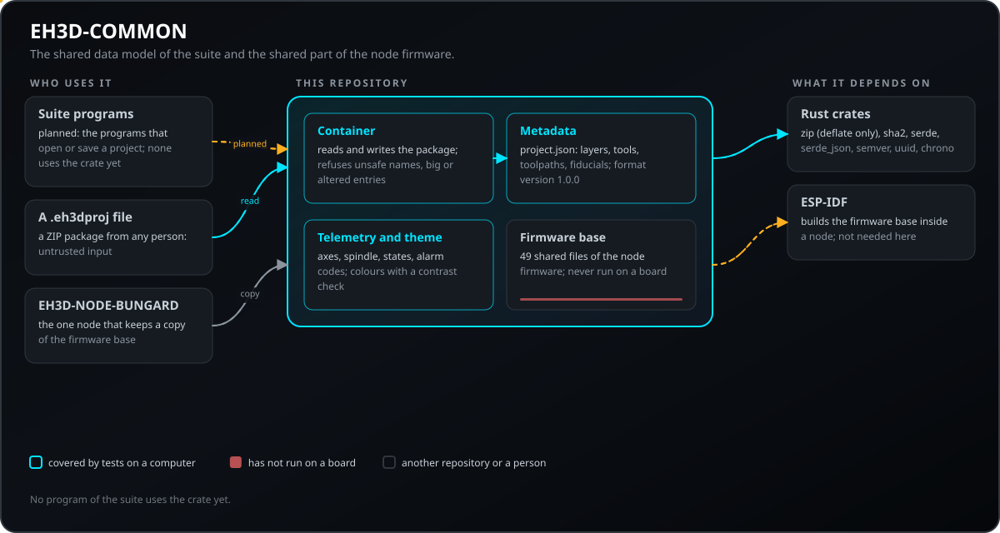
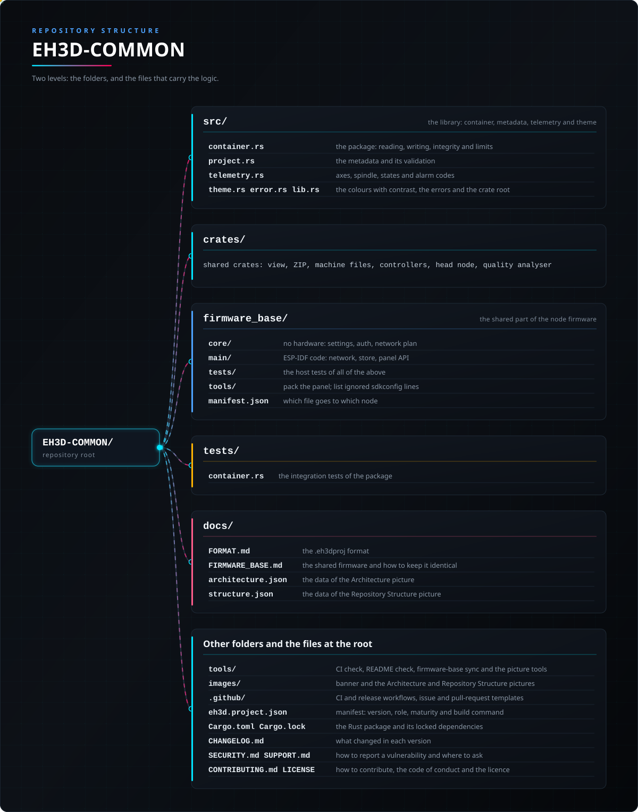

<p align="center">
  
</p>

# 🧱 EH3D-COMMON

<p align="center"><a href="README.md">🇺🇸 English</a> | <a href="README_spa.md">🇪🇸 Español</a> | <a href="README_fra.md">🇫🇷 Français</a> | <a href="README_ita.md">🇮🇹 Italiano</a> | <a href="README_deu.md">🇩🇪 Deutsch</a> | <a href="README_zho.md">🇨🇳 中文</a> | <a href="README_jpn.md">🇯🇵 日本語</a> | 🇵🇹 <b>Português</b></p>

### O modelo de dados partilhado da EH3D Fabrication Suite: contentor de projeto, metadados, verificações de integridade e telemetria de máquina

<p align="center">
  
  
  
  
  
</p>

---

**Verificação de honestidade - o que funciona hoje:** uma biblioteca em Rust com o contentor de projeto (`.eh3dproj`), os metadados de um projeto, as verificações de integridade SHA-256, os tipos de telemetria de máquina e as cores da suite, mais a base de firmware que cada nó ESP32 da suite copia (70 ficheiros e a ferramenta que mantém as cópias idênticas). 115 testes correm num computador. Os programas de furação e de fresagem e a interface moderna leem os seus ficheiros e desenham os seus trabalhos com os crates partilhados; nada aqui foi executado numa máquina nem numa placa.

---

> **Estado de segurança (safety) e de segurança informática:** esta biblioteca não é um sistema de segurança (safety) e nenhuma máquina foi controlada com ela. O contentor deteta um pacote danificado ou alterado por acidente, mas não está assinado nem cifrado: não prova quem escreveu um projeto. Um pacote de outra pessoa é uma entrada não confiável, por isso os nomes, os tamanhos e o número de entradas são limitados.

## 📋 Num relance

| | |
|---|---|
| Versão | `0.0.4` |
| Maturidade | Estrutura inicial |
| Testes | 115 |
| Tecnologias | Rust (crate de biblioteca) e C++17 (base de firmware) |
| Em hardware real | Não se aplica: uma biblioteca de dados, nada aqui fala com uma máquina; a base de firmware nunca correu numa placa |

**Ir para:** [Visão geral](#-visão-geral) · [Arquitetura](#-arquitetura) · [Início rápido](#-início-rápido) · [Testes](#-testes) · [Estrutura](#-estrutura-do-repositório) · [Relacionados](#-projetos-relacionados)

## 🚦 Estado do projeto

Cada linha é uma parte deste repositório e a luz diz até onde chega hoje. É escrita com o que o repositório consegue demonstrar (testes, compilações, execuções), não com o que está previsto.

🟢 Feito e verificado · 🟡 Funciona, com limites conhecidos · 🟠 Feito a meio ou ainda por verificar · 🔴 Por fazer ou a não funcionar

| Área | Estado | O que significa aqui |
|---|---|---|
| Contentor | 🟡 | `.eh3dproj` é um ZIP padrão com um registo SHA-256 de cada entrada; lê, escreve e recusa entradas danificadas, alteradas, não listadas ou inseguras. Até agora só os seus próprios testes o leem e escrevem. |
| Metadados | 🟡 | Os metadados de um projeto (unidades, zero, camadas, ferramentas, trajetórias, fiduciais) são validados e levam uma versão de formato semântica; ainda não há migração porque 1.0.0 é o primeiro formato. |
| Telemetria e tema | 🟢 | Eixos, fuso, estados da máquina, os códigos de alarme GRBL com a sua gravidade e as cores da suite com verificação de contraste, tudo testado. |
| Testes | 🟢 | Passam 115 testes (`cargo test --workspace`): 16 nos módulos e 14 sobre o contentor do crate principal, e 85 nos oito crates partilhados. |
| Segurança | 🟡 | Recusam-se nomes inseguros, entradas demasiado grandes ou numerosas e qualquer entrada alterada; o pacote não está assinado nem cifrado e não teve revisão independente. |
| Base de firmware | 🟠 | 49 ficheiros partilhados pelos nós ESP32, mantidos idênticos por `tools/sync_firmware_base.py`; testada só através do EH3D-NODE-BUNGARD, o único nó que a usa, e nunca executada numa placa. |
| Uso por outros programas | 🟡 | Os crates do workspace são usados por EH3D-DRILLPRO, EH3D-ROUTEPRO, EH3D-BUNGARD-GUI, EH3D-MOTIONCNC e EH3D-SERVER (por caminho, com os repositórios lado a lado); o contentor de projeto em si ainda não é usado por nenhum programa. |
| Documentação | 🟢 | README em oito idiomas, a descrição do formato e o guia da base de firmware; a CI compara-os com o manifesto e o registo de alterações. |

## 🎯 Visão geral

* O **contentor de projeto**: um pacote `.eh3dproj` é um arquivo ZIP padrão com `project.json`, `integrity.json` e as pastas `layers/`, `toolpaths/` e `vision/`. A escrita é determinista (o mesmo conteúdo dá os mesmos bytes) e passa por um ficheiro temporário.
* Os **metadados** de um projeto: nome, identidade, unidades, zero da peça, camadas, ferramentas, trajetórias e fiduciais, com uma versão de formato semântica (hoje 1.0.0). Uma versão maior mais recente é recusada em vez de ser entendida a meio; uma mais antiga precisa de uma migração registada, e ainda não existe nenhuma.
* O **registo de integridade**: o SHA-256 e o tamanho de cada entrada. Um pacote cuja entrada mudou, falta ou não está listada não abre.
* Os **limites**: recusam-se os nomes de entrada que poderiam sair da pasta do pacote, e também as entradas demasiado grandes ou numerosas.
* Os **tipos de telemetria**: eixos, fuso, estados da máquina lidos das palavras de estado e os nove códigos de alarme GRBL com a sua gravidade (aviso ou crítico; um código desconhecido conta como crítico).
* O **tema**: as cores da suite, com uma verificação de contraste WCAG que os testes aplicam a cada cor de texto e de estado.
* A **base de firmware dos nós** (`firmware_base/`, com `tools/sync_firmware_base.py`): a parte do firmware dos nós ESP32 que todos os nós EH3D partilham - o documento de definições, a rede, o servidor do painel, utilizadores e sessões, a atualização com reversão, o registo, a autoproteção e os testes que os acompanham - escrita uma vez com o nome do projeto como marcadores. Cada nó guarda a sua cópia e compila por si; a ferramenta escreve a base em cada nó e avisa quando uma cópia se desviou.
* Os **crates partilhados** do workspace: `eh3d-view` (o trabalho na mesa, onze temas, as palavras da interface em oito idiomas), `eh3d-archive` (trabalhos em arquivos ZIP), `eh3d-bungard-formats` (os ficheiros Excellon, HP-GL, tabelas de ferramentas e configuração, os contornos Gerber e DXF), `eh3d-controller` (a interface dos controladores de máquina, GRBL e um simulado), `eh3d-filedialog` (as janelas Abrir e Guardar) e `eh3d-fleet` (as máquinas e estações do servidor).
* **A altura da mesa e o nó da cabeça de furação:** `eh3d-levelling` guarda o mapa de alturas da mesa de uma máquina (uma grelha de pontos medidos, a superfície entre eles por interpolação, a inclinação e a diferença, a correção do Z de um trabalho e uma forma de texto para guardar o mapa), e `eh3d-aux` é o cliente do EH3D-NODE-BUNGARD-AUX (o seu estado, a sua medição da mesa, a sua câmara como MJPEG, os pedidos com o token e um pequeno cliente HTTP).

## 🧩 Papel no EH3D

O EH3D-COMMON é a base da suite. Os crates do seu workspace (a vista e os temas, os arquivos ZIP, os ficheiros das máquinas Bungard, os controladores de máquina, as janelas de ficheiros e a frota do servidor) são usados hoje por EH3D-DRILLPRO, EH3D-ROUTEPRO, EH3D-BUNGARD-GUI, EH3D-MOTIONCNC e EH3D-SERVER; as bibliotecas e os programas que abrem ou guardam um projeto deverão depender do contentor, e nenhum existe ainda. A base do firmware dos nós também vive aqui: o EH3D-NODE-BUNGARD é o primeiro nó que a usa.

## 🏛️ Arquitetura

<p align="center">
  
</p>

Como as partes deste repositório se encaixam: quem o usa, o que contém e de que depende. A imagem é desenhada a partir de `docs/architecture.json` e verificada com o código.

## ✨ Funcionalidades

* **Escrita determinista e atómica:** o mesmo projeto dá sempre os mesmos bytes e o ficheiro é escrito através de um temporário, por isso uma escrita falhada não deixa um pacote a meio.
* **Tudo verificado na leitura:** primeiro nomes, número e tamanhos, depois o registo de integridade contra cada entrada e por fim os metadados; o primeiro problema para a leitura com um erro tipado.
* **Um formato que qualquer ferramenta abre:** ZIP simples (só deflate) e JSON simples, legíveis sem este crate; `docs/FORMAT.md` é o contrato escrito.
* **Os leitores continuam compatíveis:** lê-se a mesma versão maior ignorando o que não se conhece; uma versão maior mais recente é recusada.
* **Códigos de alarme que não se perdem:** um código que este crate não conhece fica como `Unknown(n)` e é tratado como crítico.
* **Uma base de firmware para todos os nós:** edita-se onde surgiu a necessidade, faz-se `import`, faz-se `sync` nos outros e o `check` da CI avisa quando uma cópia se desvia.

## 🔒 Segurança e proteção

O contentor lê ficheiros que outras pessoas podem enviar, por isso cada verificação abaixo é uma defesa contra um pacote hostil ou danificado, e cada uma tem o seu teste.

| Ameaça | Defesa |
|---|---|
| Um nome que sai da pasta do pacote (`../x`, `/etc/x`, `C:\x`) | `check_entry_name` recusa um nome vazio, absoluto ou demasiado longo (mais de 240 bytes), uma barra invertida, dois pontos, um carácter de controlo e qualquer parte vazia, `.` ou `..`, ao escrever e outra vez para cada nome encontrado num ZIP |
| Uma bomba zip ou um pacote com um número enorme de entradas | no máximo 10 000 entradas, 256 MiB por entrada e 1 GiB no total; a leitura de uma entrada pára um byte acima do seu limite |
| Uma entrada alterada pelo caminho (por acidente ou de propósito) | o SHA-256 e o tamanho de cada entrada são comparados com `integrity.json`; uma entrada diferente, em falta ou não listada faz recusar todo o pacote |
| Duas entradas com o mesmo nome | recusadas como duplicado na leitura, e uma entrada substituída na escrita mantém uma só cópia |
| Um pacote de um programa mais recente | uma versão maior de formato mais recente é recusada em vez de ser entendida a meio |
| Metadados incoerentes (nome vazio, id de ferramenta repetido, NaN, diâmetro negativo, uma camada fora de `layers/`) | `validate` corre antes de escrever e depois de ler; um projeto inválido não pode ser escrito |
| Sem código unsafe | o crate é `#![forbid(unsafe_code)]` |

**O que não é defendido:** o pacote não está assinado nem cifrado. Quem puder reescrever as entradas pode reescrever também o registo de integridade, por isso deteta danos e acidentes, não um autor. A biblioteca não teve revisão independente. Comunique uma vulnerabilidade em privado (ver [SECURITY.md](SECURITY.md)).

## 🔌 Interfaces

| Interface | O que é | Onde |
|---|---|---|
| API Rust | `Package` (`new`, `add_entry`, `entry`, `entry_names`, `integrity`, `write`, `write_to_path`, `to_bytes`, `read`, `read_from_path`), `ProjectMetadata` (`new`, `validate`, `to_json`, `read_metadata`), os tipos de telemetria e `theme` | `src/` |
| Formato de ficheiro | `.eh3dproj`: um ZIP com `project.json`, `integrity.json` e as pastas de dados `layers/`, `toolpaths/` e `vision/` | [docs/FORMAT.md](docs/FORMAT.md) |
| Erros | um só enum `Error`: `Io`, `Json`, `Zip`, `UnsupportedFormat`, `MissingEntry`, `Integrity`, `UnsafePath`, `DuplicateEntry`, `TooLarge`, `InvalidMetadata` | `src/error.rs` |
| Ferramenta da base de firmware | `python tools/sync_firmware_base.py check`, `sync`, `import <nó>` e `status` | [docs/FIRMWARE_BASE.md](docs/FIRMWARE_BASE.md) |

Este repositório não tem programa de linha de comandos, nem servidor, nem acesso à rede.

## ⚙️ Configuração

A biblioteca não tem ficheiro de configuração: os seus limites são constantes do código, listadas aqui para que se saiba o que um pacote pode conter. A versão do formato faz parte do ficheiro, não é uma definição.

| Valor | Limite | Onde |
|---|---|---|
| Entradas num pacote | de 1 a 10 000 | `MAX_ENTRIES` em `src/container.rs` |
| Tamanho de uma entrada | até 256 MiB (268 435 456 bytes) | `MAX_ENTRY_BYTES` |
| Tamanho de todas as entradas juntas | até 1 GiB | `MAX_TOTAL_BYTES` |
| Comprimento do nome de uma entrada | de 1 a 240 bytes | `check_entry_name` |
| Pastas de dados | só `layers/`, `toolpaths/`, `vision/` | `DATA_FOLDERS` em `src/project.rs` |
| Versão do formato | 1.0.0 (lê-se a mesma versão maior, recusa-se uma mais recente) | `FORMAT_VERSION` |
| Diâmetro da ferramenta | finito e maior que 0 | `ProjectMetadata::validate` |

A base de firmware tem o seu próprio documento de definições (`node_settings.hpp`, `config_common.hpp`); os seus valores pertencem a cada nó e estão descritos no README do EH3D-NODE-BUNGARD.

## 🚀 Início rápido

Precisa de uma toolchain Rust estável (1.75 ou mais recente).

```rust
use eh3d_common::{Package, ProjectMetadata};

fn main() -> eh3d_common::Result<()> {
    let mut package = Package::new(ProjectMetadata::new("Test board"));
    package.add_entry("layers/top.gbr", b"G04 test*".to_vec())?;
    package.write_to_path(std::path::Path::new("board.eh3dproj"))?;
    let again = Package::read_from_path(std::path::Path::new("board.eh3dproj"))?;   // verifica cada entrada
    println!("{} data entries", again.entry_names().count());
    Ok(())
}
```

```bash
cargo build --release
cargo test
cargo clippy --all-targets -- -D warnings
cargo fmt --check
python -I tools/ci_validate.py
python -I tools/sync_firmware_base.py check
```

## 🧪 Testes

A suite tem 115 testes (`cargo test --workspace`, executados em Windows e Linux na CI): 16 dentro dos módulos (os metadados e a sua validação, os códigos de alarme e os estados da máquina, as cores e o seu contraste WCAG) e 14 sobre o contentor (ida e volta em memória e em ficheiro, os mesmos bytes para o mesmo conteúdo, o registo de integridade, uma entrada alterada, um tamanho alterado, uma entrada não listada, uma entrada em falta, metadados editados, um ficheiro que não é um pacote, nomes de entrada inseguros e hostis, uma entrada substituída e um projeto inválido). A CI executa também `cargo fmt --check` e `cargo clippy` com avisos como erros, `python -I tools/ci_validate.py` (manifesto, versões, registo de alterações e os oito README) e `tools/sync_firmware_base.py check` (as cópias da base de firmware). Os testes no computador da base de firmware (`firmware_base/tests/`) correm dentro do EH3D-NODE-BUNGARD, não aqui. Os oito crates partilhados acrescentam 85: os arquivos de trabalho (6), os ficheiros das máquinas Bungard, com os arcos, círculos e escala do HP-GL e os contornos Gerber e DXF (16), os controladores de máquina numa linha simulada (19) e a cena, as vistas, os temas e as palavras da interface em oito idiomas (20), as janelas Abrir e Guardar (7), as máquinas e estações do servidor (5) e o mapa de alturas da mesa (8) e o cliente do nó da cabeça de furação (4).

## 🏗️ Compilação e publicação

A versão vive em `Cargo.toml` e em `eh3d.project.json`, e cada versão tem a sua entrada em [CHANGELOG.md](CHANGELOG.md). As versões são publicadas no GitHub; a biblioteca usa-se como crate Rust a partir deste repositório e não está no crates.io.

## 📂 Estrutura do repositório

<p align="center">
  
</p>

<details>
<summary>Versão em texto da árvore</summary>

```text
EH3D-COMMON/
├── src/
│   ├── container.rs                             o pacote: leitura, escrita, integridade e limites
│   ├── project.rs                               os metadados e a sua validação
│   ├── telemetry.rs                             eixos, fuso, estados e códigos de alarme
│   └── theme.rs error.rs lib.rs                 as cores com contraste, os erros e a raiz do crate
├── crates/                                      crates partilhados: vista, ZIP, ficheiros de máquina, controladores
├── firmware_base/
│   ├── core/                                    sem hardware: definições, autenticação, plano de rede
│   ├── main/                                    código ESP-IDF: rede, armazenamento, API do painel
│   ├── tests/                                   os testes no computador de tudo isto
│   ├── tools/                                   empacota o painel; lista linhas sdkconfig ignoradas
│   └── manifest.json                            que ficheiro vai para que nó
├── tests/                                       o pacote: ida e volta, entradas alteradas, em falta e não listadas, nomes inseguros
├── docs/                                        o formato, a base de firmware e os dados das duas imagens
├── tools/                                       verificação da CI e do README, sincronização da base de firmware e ferramentas de imagens
├── images/                                      banner e as imagens de Arquitetura e Estrutura do repositório
├── .github/                                     fluxos de CI e de publicação, modelos de issues e pull requests
├── eh3d.project.json                            manifesto: versão, papel, maturidade e comando de compilação
├── Cargo.toml Cargo.lock                        o pacote Rust e as suas dependências fixadas
├── CHANGELOG.md                                 o que mudou em cada versão
├── SECURITY.md SUPPORT.md                       como comunicar uma vulnerabilidade e onde perguntar
└── CONTRIBUTING.md CODE_OF_CONDUCT.md LICENSE   como contribuir, o código de conduta e a licença
```

</details>

## 🗺️ Roteiro e limites conhecidos

**Limites conhecidos hoje**

* Nenhum programa usa ainda o contentor de projeto, por isso o formato só foi lido e escrito pelos seus próprios testes.
* O pacote não está assinado nem cifrado, e a biblioteca não teve revisão independente.
* Não há migração, porque 1.0.0 é o primeiro formato.
* A base de firmware só foi exercitada através do EH3D-NODE-BUNGARD e nunca correu numa placa; ainda não existe um segundo nó.
* A biblioteca não está publicada no crates.io.

**A seguir**

* Fazer o primeiro programa da suite abrir e guardar um projeto com ela (primeiro o EH3D-CORE-LIBS).
* Acrescentar o segundo nó à base de firmware e verificar que as cópias continuam idênticas.
* Decidir se os pacotes precisam de uma assinatura opcional.

## 🌍 Idiomas

O README e os textos existem em inglês, espanhol, francês, italiano, alemão, chinês, japonês e português europeu.

## 🔗 Projetos relacionados

* [EH3D-CORE-LIBS](https://github.com/JuanenRac/EH3D-CORE-LIBS): os analisadores (Excellon, Gerber) e a geometria que usarão estes tipos
* [EH3D-NODE-BUNGARD](https://github.com/JuanenRac/EH3D-NODE-BUNGARD): o primeiro nó que guarda uma cópia da base de firmware
* [EH3D-SERVER](https://github.com/JuanenRac/EH3D-SERVER): o centro da família; ainda não usa o contentor de projeto
* [EH3D-DOCS](https://github.com/JuanenRac/EH3D-DOCS): o centro de documentação da suite e o seu mapa de projetos
* [HYDRA-UMC](https://github.com/JuanenRac/HYDRA-UMC): a plataforma de robótica cujas máquinas a suite deverá manejar no futuro

## 📚 Documentação

* [Formato de projeto](docs/FORMAT.md): as entradas, os metadados, o registo de integridade e as regras para os leitores.
* [A base de firmware](docs/FIRMWARE_BASE.md): o que se partilha, como se mantém idêntico e como acrescentar um nó.
* [Registo de alterações](CHANGELOG.md)

## 🤝 Contribuir e comunidade

* Antes de um pull request execute `cargo fmt --check`, `cargo clippy --all-targets -- -D warnings`, `cargo test`, `python -I tools/ci_validate.py` e `python -I tools/sync_firmware_base.py check`: tudo tem de passar. Consulte [CONTRIBUTING.md](CONTRIBUTING.md) e o [código de conduta](CODE_OF_CONDUCT.md).
* O README existe em oito idiomas: uma alteração ao texto faz-se nos oito ficheiros, e as duas imagens são desenhadas a partir de `docs/architecture.json` e `docs/structure.json` com `tools/make_architecture.py` e `tools/make_structure.py`.
* Uma alteração à base de firmware faz-se num nó, importa-se com `tools/sync_firmware_base.py import` e sincroniza-se nos outros; nunca edite uma cópia à mão.
* Comunique uma vulnerabilidade em privado: [SECURITY.md](SECURITY.md). Perguntas, ideias e relatórios: electrohobby3d@gmail.com ([SUPPORT.md](SUPPORT.md)).

## 👤 AUTOR

**JuanenRac (Electro Hobby 3D)** · electrohobby3d@gmail.com

## 📜 LICENÇA

Software: GPL-3.0-or-later. Ver [LICENSE](LICENSE). Os projetos de hardware da suite usam a CERN OHL-S.
