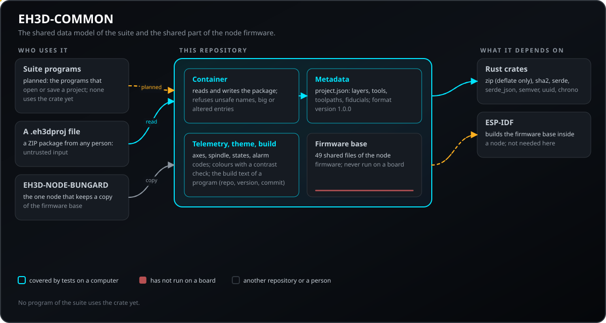
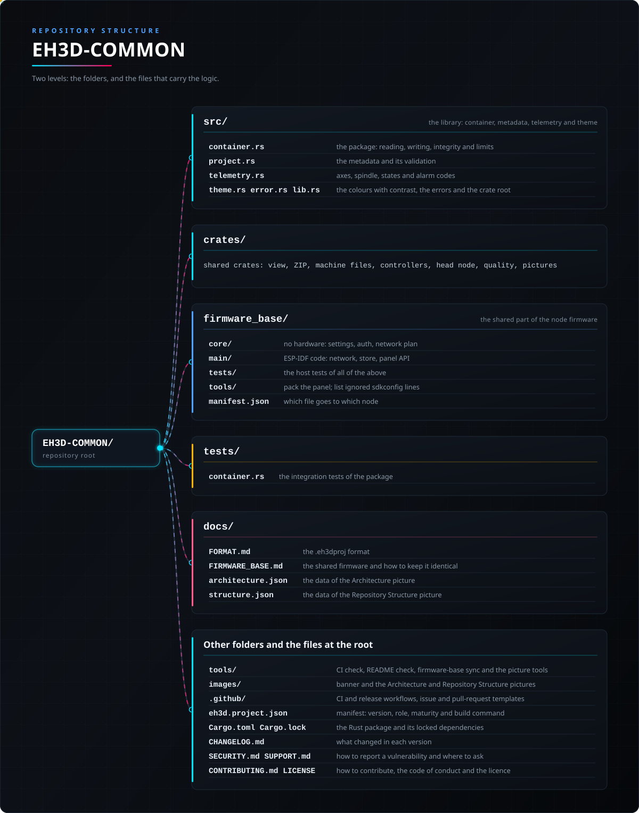

<p align="center">
  
</p>

# 🧱 EH3D-COMMON

<p align="center"><a href="README.md">🇺🇸 English</a> | 🇪🇸 <b>Español</b> | <a href="README_fra.md">🇫🇷 Français</a> | <a href="README_ita.md">🇮🇹 Italiano</a> | <a href="README_deu.md">🇩🇪 Deutsch</a> | <a href="README_zho.md">🇨🇳 中文</a> | <a href="README_jpn.md">🇯🇵 日本語</a> | <a href="README_por.md">🇵🇹 Português</a></p>

### El modelo de datos compartido de la EH3D Fabrication Suite: contenedor de proyecto, metadatos, comprobaciones de integridad y telemetría de máquina

<p align="center">
  
  
  
  
  
</p>

---

**Comprobación de honestidad - lo que se ejecuta hoy:** una biblioteca en Rust con el contenedor de proyecto (`.eh3dproj`), los metadatos de un proyecto, las comprobaciones de integridad SHA-256, los tipos de telemetría de máquina y los colores de la suite, más la base de firmware que copia cada nodo ESP32 de la suite (71 ficheros y la herramienta que mantiene las copias idénticas). 1177 pruebas se ejecutan en un ordenador. Los programas de taladrado y de fresado y la interfaz moderna leen sus ficheros y dibujan sus trabajos con los crates compartidos; nada de aquí se ha ejecutado en una máquina ni en una placa.

---

> **Estado de seguridad (safety) y de seguridad informática:** esta biblioteca no es un sistema de seguridad (safety) y con ella no se ha controlado ninguna máquina. El contenedor detecta un paquete dañado o alterado por accidente, pero no está firmado ni cifrado: no prueba quién escribió un proyecto. Un paquete de otra persona es una entrada no confiable, por eso se limitan los nombres, los tamaños y el número de entradas.

## 📋 De un vistazo

| | |
|---|---|
| Versión | `0.3.5` |
| Madurez | Andamiaje |
| Pruebas | 1177 |
| Pila tecnológica | Rust (crate de biblioteca) y C++17 (base de firmware) |
| En hardware real | No aplica: una biblioteca de datos, nada aquí habla con una máquina; la base de firmware nunca se ha ejecutado en una placa |

**Ir a:** [Resumen](#-resumen) · [Arquitectura](#-arquitectura) · [Inicio rápido](#-inicio-rápido) · [Pruebas](#-pruebas) · [Estructura](#-estructura-del-repositorio) · [Relacionados](#-proyectos-relacionados)

## 🚦 Estado del proyecto

Cada línea es una parte de este repositorio y la luz dice hasta dónde llega hoy. Se escribe con lo que el repositorio puede demostrar (pruebas, compilaciones, ejecuciones), no con lo previsto.

🟢 Hecho y verificado · 🟡 Funciona, con límites conocidos · 🟠 Hecho a medias o sin verificar · 🔴 Sin hacer o sin funcionar

| Área | Estado | Qué significa aquí |
|---|---|---|
| Contenedor | 🟡 | `.eh3dproj` es un ZIP estándar con un registro SHA-256 de cada entrada; lee, escribe y rechaza entradas dañadas, alteradas, sin listar o inseguras. Hasta ahora solo lo leen y escriben sus propias pruebas. |
| Metadatos | 🟡 | Los metadatos de un proyecto (unidades, cero, capas, herramientas, trayectorias, fiduciales) se validan y llevan una versión de formato semántica; aún no hay migración porque 1.0.0 es el primer formato. |
| Telemetría y tema | 🟡 | Ejes, husillo, estados de la máquina, los códigos de alarma GRBL con su gravedad y los colores de la suite con comprobación de contraste, todo probado. |
| Pruebas | 🟡 | Pasan 1177 pruebas (`cargo test --workspace`): 26 en los módulos y 34 sobre el contenedor del crate principal, y 1117 en los veintidós crates compartidos. |
| Seguridad | 🟡 | Se rechazan los nombres inseguros, las entradas demasiado grandes o numerosas y cualquier entrada alterada; el paquete no está firmado ni cifrado y no ha tenido revisión independiente. |
| Base de firmware | 🟠 | 95 ficheros mantenidos idénticos por `tools/sync_firmware_base.py`: 50 compartidos por los nodos ESP32 EH3D-NODE-BUNGARD y EH3D-NODE-BUNGARD-AUX (48 de ellos por los dos; probados solo en un ordenador, con las pruebas de anfitrión de esos dos nodos) y 45 compartidos por las dos pantallas táctiles EH3D-NODE-BUNGARD-HMI y EH3D-NODE-HMI-GUI; nunca ejecutada en una placa. |
| Uso por otros programas | 🟡 | Los crates del workspace los usan EH3D-DRILLPRO, EH3D-ROUTEPRO, EH3D-BUNGARD-GUI, EH3D-PHOENIX-CNC y EH3D-SERVER (por ruta, con los repositorios uno junto a otro); el contenedor de proyectos todavía no lo usa ningún programa. |
| Documentación | 🟡 | README en ocho idiomas, la descripción del formato y la guía de la base de firmware; el CI las compara con el manifiesto y el registro de cambios. |

## 🎯 Resumen

* El **contenedor de proyecto**: un paquete `.eh3dproj` es un archivo ZIP estándar con `project.json`, `integrity.json` y las carpetas `layers/`, `toolpaths/` y `vision/`. El escritor es determinista (el mismo contenido da los mismos bytes) y escribe a través de un fichero temporal.
* Los **metadatos** de un proyecto: nombre, identidad, unidades, cero de la pieza, capas, herramientas, trayectorias y fiduciales, con una versión de formato semántica (hoy 1.0.0). Una versión mayor más nueva se rechaza en lugar de entenderse a medias; una más antigua necesita una migración registrada, y todavía no existe ninguna.
* El **registro de integridad**: el SHA-256 y el tamaño de cada entrada. Un paquete cuya entrada cambió, falta o no está listada no se abre.
* Los **límites**: se rechazan los nombres de entrada que podrían salir de la carpeta del paquete, y también las entradas demasiado grandes o demasiado numerosas.
* Los **tipos de telemetría**: ejes, husillo, estados de la máquina leídos de las palabras de estado y los nueve códigos de alarma GRBL con su gravedad (aviso o crítica; un código desconocido cuenta como crítico).
* El **texto de compilación**: qué compilación de un programa se ejecuta (repositorio, versión, commit y tipo) como un JSON pequeño que lleva el binario, con un lector estricto y los códigos `EH3D-BUILD-001` a `EH3D-BUILD-008` ([docs/BUILD.md](docs/BUILD.md)).
* El **tema**: los colores de la suite, con una comprobación de contraste WCAG que las pruebas aplican a cada color de texto y de estado.
* La **base de firmware de los nodos** (`firmware_base/`, con `tools/sync_firmware_base.py`): la parte del firmware de los nodos ESP32 que comparten todos los nodos EH3D - el documento de ajustes, la red, el servidor del panel, usuarios y sesiones, la actualización con vuelta atrás, el registro, la autoprotección y las pruebas que los acompañan - escrita una vez con el nombre del proyecto como marcadores. Cada nodo guarda su propia copia y compila por su cuenta; la herramienta escribe la base en cada nodo y avisa cuando una copia se ha desviado.
* Los **crates compartidos** del workspace: `eh3d-view` (el trabajo en la mesa, once temas, las palabras de la interfaz en ocho idiomas), `eh3d-archive` (trabajos en archivos ZIP), `eh3d-bungard-formats` (los ficheros Excellon, HP-GL, tablas de herramientas y configuración, los contornos Gerber y DXF), `eh3d-controller` (la interfaz de los controladores de máquina, GRBL, Marlin y Klipper, cuyo mayor recorrido se puede leer, y las máquinas simuladas en las que se prueban, con un cable que estropea los mensajes según una semilla), `eh3d-filedialog` (las ventanas Abrir y Guardar) y `eh3d-fleet` (las máquinas y estaciones del servidor) y `eh3d-serverclient` (el cliente único del servidor: inicio de sesión y renovación, los errores por código en ocho idiomas, reintentos, el estado del enlace, una cola para las peticiones que esperan mientras el servidor no está, la caché del contrato que avisa de las rutas retiradas, las métricas del enlace, las cabeceras y los cuerpos de bytes con la regla de la etiqueta del almacén de proyectos (`ETag`, `If-Match`, los rechazos 428 y 412) y una búsqueda mDNS opcional y apagada por defecto; el panel de sus ajustes, la lista de sesiones y el indicador del enlace están en `eh3d-view`), y `eh3d-dock` (el marco de las ventanas profesionales: paneles que se acoplan, flotan, se pliegan y se bloquean, espacios de trabajo con nombre, una barra de menús declarada como datos y atajos de teclado, en ocho idiomas; el dibujo con egui es la característica `gui`; guía en [docs/DOCKING.md](docs/DOCKING.md)). Con él un programa de la familia PHOENIX pone su color en los acentos de su ventana y guarda sus proyectos recientes en la carpeta del usuario.
* **Las vistas estándar de la máquina:** `eh3d_view::views` dibuja la mesa y el volumen de la máquina desde arriba (una planta real: X a la derecha, Y arriba, la altura no mueve el punto), de frente (X a la derecha, Z arriba), de lado (Y a la derecha, Z arriba) y en la vista isométrica habitual, todas con la misma escala en ambos ejes de la pantalla, y ajusta cualquiera de ellas a una caja de la máquina en un área de píxeles con un margen. La proyección de `Iso` no cambia.
* **La altura de la mesa y el nodo del cabezal de taladro:** `eh3d-levelling` guarda el mapa de alturas de la mesa de una máquina (una malla de puntos medidos, la superficie entre ellos por interpolación, la inclinación y la diferencia, la corrección de la Z de un trabajo y una forma de texto para guardar el mapa), y `eh3d-aux` es el cliente de EH3D-NODE-BUNGARD-AUX (su estado, su medida de la mesa, su cámara como MJPEG, las peticiones con el token y un pequeño cliente HTTP).

## 🧩 Papel en EH3D

EH3D-COMMON es la base de la suite. Los crates de su workspace (la vista y los temas, los archivos ZIP, los ficheros de las máquinas Bungard, los controladores de máquina, las ventanas de ficheros y la flota del servidor) los usan hoy EH3D-DRILLPRO, EH3D-ROUTEPRO, EH3D-BUNGARD-GUI, EH3D-PHOENIX-CNC y EH3D-SERVER; está previsto que las bibliotecas y los programas que abren o guardan un proyecto dependan del contenedor, y ninguno existe todavía. La base del firmware de los nodos también vive aquí: EH3D-NODE-BUNGARD es el primer nodo que la usa.

## 🏛️ Arquitectura

<p align="center">
  
</p>

Cómo encajan las partes de este repositorio: quién lo usa, qué contiene y de qué depende. La imagen se dibuja desde `docs/architecture.json` y se comprueba contra el código.

## ✨ Funciones

* **Escritura determinista y atómica:** el mismo proyecto da siempre los mismos bytes y el fichero se escribe a través de uno temporal, así que una escritura fallida no deja un paquete a medias.
* **Todo comprobado al leer:** primero nombres, número y tamaños, luego el registro de integridad contra cada entrada y por último los metadatos; el primer problema detiene la lectura con un error tipado.
* **Un formato que abre cualquier herramienta:** ZIP normal (solo deflate) y JSON normal, legible sin este crate; `docs/FORMAT.md` es el contrato escrito.
* **Los lectores siguen siendo compatibles:** se lee la misma versión mayor ignorando lo que no se conoce; una versión mayor más nueva se rechaza.
* **Códigos de alarma que no se pierden:** un código que este crate no conoce se conserva como `Unknown(n)` y se trata como crítico.
* **Una base de firmware para todos los nodos:** se edita donde apareció la necesidad, se hace `import`, se hace `sync` en los demás y el `check` del CI avisa cuando una copia se desvía.
* **El analizador de calidad y el aro de LEDs del cabezal:** `eh3d-inspect` juzga una foto de la cámara del cabezal de taladro (agujeros que están, redondos, del tamaño justo y en su sitio; canales fresados tan anchos como la herramienta, regulares y sin estrechamientos; una foto lo bastante buena para juzgar) con un perfil de tolerancias, y dice correcto, no correcto o no se puede juzgar. `eh3d-aux` también enciende y apaga el aro de LEDs de la cámara, muestra en color cómo fue una verificación, toma una foto y entrega el perfil al servidor.
* **El diagnóstico y el contenedor de los formatos nuevos:** `eh3d-diagnostic` es el hallazgo común de todo lector (un código estable, una gravedad, un mensaje, dónde ocurrió, una forma JSON y una forma redactada). `eh3d-container` guarda lo que comparten todos los contenedores de proyecto: los parámetros de un formato, el registro de integridad, el JSON canónico, la política estricta de nombres y ZIP con los códigos `EH3D-PKG-001` a `EH3D-PKG-024`, un lector en flujo con límites, un escritor determinista en flujo y el reemplazo atómico del destino (reintentado un momento si otro programa tiene el archivo en Windows). El código de `.eh3dproj` 1.0.0 de este crate no cambia. La carpeta `crates/auxnode` es el paquete `eh3d-aux`.
* **El contenedor de proyecto con ramas (`eh3d-project`):** un archivo `.eh3d` con una rama por programa (`pcb/`, `cad/`, `3dp/`, `laser/`, `cnc/`, ...), `common/` con metadatos opcionales, `docs/` para la documentación en los ocho idiomas y `manufacturing/`, que guarda un paquete `.eh3dproj` 1.0.0 y lo devuelve byte a byte. Cada programa escribe solo su propia rama y los bytes de las demás nunca cambian; una rama derivada de otra se advierte cuando su origen cambió; una rama desconocida se conserva tal cual. Los códigos `EH3D-PKG-015` a `EH3D-PKG-024` son suyos. Las ramas y el proyecto entero se pueden firmar con Ed25519 (`ed25519-dalek`): las claves son archivos fuera del proyecto, nunca se imprimen ni se guardan en él, y al abrir se dice de cada firma si está firmada y es válida, sin firmar o no válida. El sello tiene sus registros y comprobaciones; el cifrado de una rama está pendiente (véase `docs/adr/0002-eh3d-project-container.md`). Lo que cada programa hace con su rama (guardar, abrir, importar con informe, tomar de otra rama, avisos de desactualizado) está compartido en el módulo `appbranch`. El formato está en `docs/FORMAT_EH3D.md` y el comando `eh3d-project info|verify|extract-branch|keygen|sign` mira dentro de un archivo. Los programas que hacen algo a partir del trabajo (visor, plantillas, aislamiento, taladrado, fresado) lo leen y guardan su resultado con el módulo `manufacturing`, y las ventanas comparten lo que muestran antes de escribir (`suiteview`, con sus textos en los ocho idiomas en `suitetext`). Al guardar no se vuelve a comprimir lo que no ha cambiado (adjuntos incluidos), y cada entrada del fichero nuevo se comprueba antes de sustituir al anterior.
* **Adjuntos de un proyecto:** cualquier fichero (hojas de datos, manuales, documentos de ofimática, proyectos y planos, vídeo, sonido o cualquier otro) puede viajar dentro del `.eh3d`, guardado una sola vez y ligado a las piezas del diseño que lo usan (referencia, valor o código del fabricante), o solo como enlace con su dirección y su hash. Los programas, scripts, documentos con macros, archivos comprimidos y páginas que pueden ejecutar código se marcan como peligrosos y solo se sacan cuando una persona lo acepta; nada se ejecuta ni se descarga. Hasta 1 GB por adjunto (configurable) y 4 GB por proyecto. Comandos `eh3d-project attach`, `attachments`, `extract-attachment` y `detach`; el formato está en `docs/FORMAT_EH3D.md` y `docs/adr/0003-eh3d-attachments.md`. Un programa los muestra con el panel «Adjuntos» de más abajo cuando lo monta.
* **El lector de imágenes:** `eh3d-image` lee ficheros PGM y PNG como niveles de gris (gris, color, paleta o transparente, de 8 o 16 bits, con la transparencia contada como blanco) con límites de tamaño para que un fichero hostil no pueda pedir gigabytes, escala una imagen con un filtro de cajas y dibuja discos sobre ella. El grabado láser y el buscador de fiduciales lo usan en lugar de una copia cada uno.
* **La comprobación antes de empezar un trabajo:** `eh3d-summary` sigue sobre el papel los pasos exactos de un plan (el bit de paso y el de dirección de cada eje, los finales de carrera que se tragan lo que va detrás) para saber hasta dónde llega cada eje y cuánto dura el trabajo, encuentra el plan que se sale del recorrido de la máquina antes de que gire un motor, hace las comprobaciones de sentido común del trabajo (una unidad equivocada, un trabajo mayor que la mesa o lejos de su esquina, una escala distinta de 1) con umbrales que vienen del ajuste de la máquina, y lo dice todo en los ocho idiomas. El programa de taladrado, el de fresado, la interfaz moderna y el servidor muestran el mismo resumen.
* **La base de datos de materiales de placa:** `eh3d-materials` guarda laminados, prepregs, flex, núcleos metálicos y placas de PTFE con los valores que publica cada fabricante (cada registro nombra su hoja de datos y un valor que la hoja no da queda vacío), los comprueba al cargarlos (identificadores únicos, Dk, Df, Tg y Td creíbles), responde por identificador, fabricante, tipo y Tg, Dk y Df mínimos, interpola Dk y Df entre las frecuencias publicadas sin extrapolar nunca, da la vista pequeña que necesita el programa de la máquina y clasifica los documentos de referencia según lo que sirven (una CNC que taladra y fresa placas, o la herramienta de diseño). Una transición vítrea que la hoja da solo como cota («por encima de 280 C») se guarda aparte de las medidas. El mismo crate tiene una segunda familia para los materiales que trabaja una fresadora CNC o un láser (55 maderas, plásticos, metales, material de placa, papel, cuero, tela, goma, espuma y vidrio, con su nombre en ocho idiomas): dice qué puede hacer un láser con cada uno y por qué no (el PVC, el ABS, el policarbonato, el vinilo, la fibra de carbono y similares se rechazan con el peligro que hay detrás) y da puntos de partida para una fresadora y un láser que se interpolan entre puntos conocidos, nunca se extrapolan y nunca se marcan como verificados; la guía es [docs/MACHINING.md](docs/MACHINING.md). Sus errores tienen los códigos `EH3D-MAT-001` a `EH3D-MAT-015`.
* **La base de datos de materiales de impresión 3D:** `eh3d-printmaterials` guarda filamentos FDM y resinas fotopolimerizables (SLA, DLP, LCD, MSLA) con los valores que publica cada fabricante (cada registro nombra su fuente, dice que no se probó en una máquina y no lleva precio), los comprueba al cargarlos, responde por material, boquilla, cama, carga y impresora, da el peso de un metro, el secado y la boquilla endurecida que necesita un filamento, y la exposición de una resina para una impresora y una altura de capa, interpolada entre puntos conocidos y nunca extrapolada, con sus avisos en ocho idiomas. Su semilla de unos 475 filamentos procede en parte de una base de datos abierta con licencia MIT (el aviso está en el crate). Sus errores tienen los códigos `EH3D-PMAT-001` a `EH3D-PMAT-009`; la guía es [docs/FILAMENTS.md](docs/FILAMENTS.md).
* **El catálogo de impresoras 3D:** `eh3d-printers` guarda, de cada modelo, el volumen de impresión, las boquillas, si es cerrada, las temperaturas máximas, el sistema multicolor, la familia del programa que hablaría con ella y los ficheros que admite, cada dato con la página pública del fabricante que lo dice y ninguno probado en una máquina (de momento las Bambu Lab A1, P1P y P1S, tres modelos de Creality y dos de Artillery; cada página dice qué cifras se leyeron en ella y cuáles faltan por comprobar, y la velocidad, la aceleración y el caudal máximos cuando el fabricante los publica). Da filamentos de partida de la base de materiales, con los motivos contra los que la máquina no puede imprimir, y procesos calculados a partir de la boquilla, en ocho idiomas; la guía es [docs/PRINTERS.md](docs/PRINTERS.md).
* **El visor de adjuntos:** `eh3d-viewer` muestra dentro de un programa las hojas de datos, los manuales y otros archivos de un proyecto: páginas de PDF con zoom y búsqueda (PDFium sin motor de scripts, en una versión y un SHA-256 fijados, cargado solo desde la carpeta del programa), imágenes, texto, Markdown y el texto y las tablas de los documentos de ofimática. Los programas, los scripts, los archivos con macros y los comprimidos muestran un aviso y preguntan antes de que nada salga del programa; un programa o un script no se ejecuta nunca. El panel es la característica `gui`, los textos están en ocho idiomas y los programas lo muestran mediante el panel de adjuntos de abajo; la guía es [docs/VIEWER.md](docs/VIEWER.md).
* **Una sola clasificación de archivos y el panel «Adjuntos»:** `eh3d-filekind` es el único sitio que dice qué es un archivo adjunto, si es peligroso y qué nombre puede tener en un disco; los programas, los scripts, los archivos con macros, los comprimidos, HTML, SVG **y los tipos que la suite no conoce** piden confirmación antes de extraerse o abrirse. `eh3d-attachpanel` es el panel que un programa PHOENIX monta con pocas líneas: la lista del proyecto, adjuntar un archivo o un enlace, ligar a un componente, extraer y quitar preguntando antes, y el visor al lado, en ocho idiomas; un archivo de ajustes que contiene el token del servidor no se mete en un proyecto. La guía es [docs/ATTACHMENTS_PANEL.md](docs/ATTACHMENTS_PANEL.md). El panel toma sus límites del fichero de ajustes del programa (`attachments.max_mb`, `viewer.max_*_mb`), recoge los archivos que se sueltan sobre él y calcula el SHA-256 de un archivo grande sin parar la ventana.
* **Ocho idiomas:** las palabras de la interfaz compartida (`eh3d-view`) existen en inglés, español, italiano, alemán, francés, portugués (de Portugal), chino y japonés. El código `pt-br` se lee como portugués y `fr-ca` como francés; el código de cualquier otro idioma no se conoce y el programa conserva el idioma que tenía.

## 🔒 Seguridad y protección

El contenedor lee ficheros que pueden enviar otras personas, así que cada comprobación de abajo es una defensa contra un paquete hostil o dañado, y cada una tiene su prueba.

| Amenaza | Defensa |
|---|---|
| Un nombre que sale de la carpeta del paquete (`../x`, `/etc/x`, `C:\x`) | `check_entry_name` rechaza un nombre vacío, absoluto o demasiado largo (más de 240 bytes), una barra invertida, dos puntos, un carácter de control y cualquier parte vacía, `.` o `..`, al escribir y de nuevo con cada nombre hallado en un ZIP |
| Una bomba zip o un paquete con un número enorme de entradas | como máximo 10 000 entradas, 256 MiB por entrada y 1 GiB en total; la lectura de una entrada se detiene un byte por encima de su límite |
| Una entrada alterada por el camino (por accidente o a propósito) | se comparan el SHA-256 y el tamaño de cada entrada con `integrity.json`; una entrada distinta, ausente o sin listar rechaza todo el paquete |
| Dos entradas con el mismo nombre | se rechazan como duplicado al leer, y una entrada reemplazada al escribir conserva una sola copia |
| Un paquete de un programa más nuevo | una versión mayor de formato más nueva se rechaza en lugar de entenderse a medias |
| Metadatos incoherentes (nombre vacío, id de herramienta repetido, NaN, diámetro negativo, una capa fuera de `layers/`) | `validate` se ejecuta antes de escribir y después de leer; un proyecto no válido no se puede escribir |
| Sin código inseguro | el crate es `#![forbid(unsafe_code)]` |

**Lo que no se defiende:** el paquete no está firmado ni cifrado. Quien pueda reescribir las entradas puede reescribir también el registro de integridad, así que detecta daños y accidentes, no a un autor. La biblioteca no ha tenido revisión independiente. Informa de una vulnerabilidad en privado (véase [SECURITY.md](SECURITY.md)).

## 🔌 Interfaces

| Interfaz | Qué es | Dónde |
|---|---|---|
| API de Rust | `Package` (`new`, `add_entry`, `entry`, `entry_names`, `integrity`, `write`, `write_to_path`, `to_bytes`, `read`, `read_from_path`), `ProjectMetadata` (`new`, `validate`, `to_json`, `read_metadata`), los tipos de telemetría y `theme`, `build` | `src/` |
| Formato de fichero | `.eh3dproj`: un ZIP con `project.json`, `integrity.json` y las carpetas de datos `layers/`, `toolpaths/` y `vision/` | [docs/FORMAT.md](docs/FORMAT.md) |
| Errores | un solo enum `Error`: `Io`, `Json`, `Zip`, `UnsupportedFormat`, `MissingEntry`, `Integrity`, `UnsafePath`, `DuplicateEntry`, `TooLarge`, `InvalidMetadata` | `src/error.rs` |
| Herramienta de la base de firmware | `python tools/sync_firmware_base.py check`, `sync`, `import <nodo>` y `status` | [docs/FIRMWARE_BASE.md](docs/FIRMWARE_BASE.md) |

Este repositorio no tiene programa de línea de comandos, ni servidor, ni acceso a la red.

## ⚙️ Configuración

La biblioteca no tiene fichero de configuración: sus límites son constantes del código, listadas aquí para que quien lea sepa qué puede contener un paquete. La versión del formato forma parte del fichero, no es un ajuste.

| Valor | Límite | Dónde |
|---|---|---|
| Entradas en un paquete | de 1 a 10 000 | `MAX_ENTRIES` en `src/container.rs` |
| Tamaño de una entrada | hasta 256 MiB (268 435 456 bytes) | `MAX_ENTRY_BYTES` |
| Tamaño de todas las entradas juntas | hasta 1 GiB | `MAX_TOTAL_BYTES` |
| Longitud de un nombre de entrada | de 1 a 240 bytes | `check_entry_name` |
| Carpetas de datos | solo `layers/`, `toolpaths/`, `vision/` | `DATA_FOLDERS` en `src/project.rs` |
| Versión del formato | 1.0.0 (se lee la misma versión mayor, se rechaza una mayor más nueva) | `FORMAT_VERSION` |
| Diámetro de herramienta | finito y mayor que 0 | `ProjectMetadata::validate` |

La base de firmware tiene su propio documento de ajustes (`node_settings.hpp`, `config_common.hpp`); sus valores pertenecen a cada nodo y se describen en el README de EH3D-NODE-BUNGARD.

## 🚀 Inicio rápido

Necesitas una cadena de herramientas estable de Rust (1.89 o posterior).

```rust
use eh3d_common::{Package, ProjectMetadata};

fn main() -> eh3d_common::Result<()> {
    let mut package = Package::new(ProjectMetadata::new("Test board"));
    package.add_entry("layers/top.gbr", b"G04 test*".to_vec())?;
    package.write_to_path(std::path::Path::new("board.eh3dproj"))?;
    let again = Package::read_from_path(std::path::Path::new("board.eh3dproj"))?;   // comprueba cada entrada
    println!("{} data entries", again.entry_names().count());
    Ok(())
}
```

```bash
cargo build --release
cargo test
cargo clippy --all-targets -- -D warnings
cargo fmt --check
python -I tools/ci_validate.py
python -I tools/sync_firmware_base.py check
```

## 🧪 Pruebas

La suite tiene 1179 pruebas (`cargo test --workspace`, ejecutadas en Windows y Linux en el CI): 26 dentro de los módulos (los metadatos y su validación, los códigos de alarma y los estados de la máquina, los colores y su contraste WCAG, el texto de compilación (el formato, los rechazos y los códigos)) y 34 sobre el contenedor (14 de ellas registran cómo se comporta hoy el formato: orden de entradas, JSON exacto, indicadores ZIP y el veredicto sobre 19 paquetes dañados; las otras cubren ida y vuelta en memoria y en fichero, los mismos bytes para el mismo contenido, el registro de integridad, una entrada cambiada, un tamaño cambiado, una entrada sin listar, una entrada ausente, metadatos editados, un fichero que no es un paquete, nombres de entrada inseguros y hostiles, una entrada reemplazada y un proyecto no válido, y una comparación de la descripción del formato con el código). El CI también ejecuta `cargo fmt --check` y `cargo clippy` con advertencias como errores, `python -I tools/ci_validate.py` (manifiesto, versiones, registro de cambios y los ocho README) y `tools/sync_firmware_base.py check` (las copias de la base de firmware). Las pruebas en el ordenador de la base de firmware (`firmware_base/tests/`) se ejecutan dentro de EH3D-NODE-BUNGARD, no aquí. Los veinte crates compartidos añaden 1098 más: los archivos de trabajo (8), los ficheros de las máquinas Bungard, con los arcos, círculos y escalado de HP-GL y los contornos Gerber y DXF (61), los controladores de máquina sobre una línea simulada (141) y la escena, las vistas, los temas y las palabras de la interfaz en ocho idiomas (87), las ventanas Abrir y Guardar (7), las máquinas y estaciones del servidor (8) y el mapa de alturas de la mesa (11) el cliente del nodo del cabezal de taladro, con el aro de LEDs y la foto (10), el lector de imágenes PGM y PNG (7), la simulación en seco y el resumen antes de un trabajo (23) y el analizador de calidad (43): los agujeros, los canales fresados, la calidad de la foto, el perfil y el veredicto, y las piezas compartidas de los formatos de contenedor: el registro de integridad, el hash de contenido, la regla de nombres y el JSON canónico, y el lector y escritor genéricos con la política estricta, los códigos `EH3D-PKG` y el reemplazo atómico (75), el contenedor de proyecto `.eh3d` con ramas: registros, referencias, permisos, sello, firmas, archivos dañados, los adjuntos y la línea de órdenes (88), y el cliente del servidor: inicio de sesión y renovación, las negativas por código con su texto en ocho idiomas, reintentos con esperas crecientes, el estado del enlace y un token que nunca se imprime (170) y el marco acoplable: la disposición y sus reparaciones, la geometría del arrastre, la forma de texto y los espacios de trabajo, los atajos y los menús, las propuestas de cada sector y el dibujo con egui (147, 22 de ellas con la característica `gui`). El diagnóstico común (6), la base de datos de materiales, de placa y de mecanizado (104) y la de materiales de impresión 3D (38) están contados en el mismo total. El catálogo de impresoras 3D tiene 24 más. El visor de adjuntos tiene 57 (2 de ellas con la característica `gui`, 3 de ellas con la biblioteca de PDF real). La clasificación única de archivos tiene 9 y el panel de adjuntos 11.

## 🏗️ Compilación y publicación

La versión vive en `Cargo.toml` y en `eh3d.project.json`, y cada versión tiene su entrada en [CHANGELOG.md](CHANGELOG.md). Las versiones se publican en GitHub; la biblioteca se consume como crate de Rust desde este repositorio y no está en crates.io.

## 📂 Estructura del repositorio

<p align="center">
  
</p>

<details>
<summary>Versión en texto del árbol</summary>

```text
EH3D-COMMON/
├── src/
│   ├── container.rs                             el paquete: lectura, escritura, integridad y límites
│   ├── project.rs                               los metadatos y su validación
│   ├── telemetry.rs                             ejes, husillo, estados y códigos de alarma
│   ├── build.rs                                 qué compilación se ejecuta: repositorio, versión, commit y tipo, como un JSON pequeño
│   └── theme.rs error.rs lib.rs                 los colores con contraste, los errores y la raíz del crate
├── crates/                                      crates compartidos: vista, ZIP, ficheros de máquina, controladores, cabezal, calidad, imágenes, resumen
├── firmware_base/
│   ├── core/                                    sin hardware: ajustes, autenticación, plan de red
│   ├── main/                                    código ESP-IDF: red, almacén, API del panel
│   ├── tests/                                   las pruebas en el ordenador de todo lo anterior
│   ├── tools/                                   empaqueta el panel; lista líneas de sdkconfig ignoradas
│   └── manifest.json                            qué fichero va a qué nodo
├── tests/                                       el paquete: idas y vueltas, entradas cambiadas, ausentes y sin listar, nombres inseguros
├── examples/                                    cómo usar el texto de compilación compartido
├── docs/                                        el formato, la base de firmware y los datos de las dos imágenes
├── tools/                                       comprobación del CI y del README, sincronización de la base de firmware y herramientas de imágenes
├── images/                                      banner y las imágenes de Arquitectura y Estructura del repositorio
├── .github/                                     flujos de CI y de publicación, plantillas de issues y pull requests
├── eh3d.project.json                            manifiesto: versión, rol, madurez y comando de compilación
├── Cargo.toml Cargo.lock                        el paquete de Rust y sus dependencias fijadas
├── rust-toolchain.toml                          la toolchain de Rust fijada
├── CHANGELOG.md                                 qué cambió en cada versión
├── SECURITY.md SUPPORT.md                       cómo informar de una vulnerabilidad y dónde preguntar
└── CONTRIBUTING.md CODE_OF_CONDUCT.md LICENSE   cómo contribuir, el código de conducta y la licencia
```

</details>

## 🗺️ Hoja de ruta y límites conocidos

**Límites conocidos hoy**

* Ningún programa usa todavía el contenedor de proyectos, así que el formato solo lo han leído y escrito sus propias pruebas.
* El paquete no está firmado ni cifrado, y la biblioteca no ha tenido revisión independiente.
* No hay migración, porque 1.0.0 es el primer formato.
* La base de firmware solo se ha ejercitado a través de EH3D-NODE-BUNGARD y nunca se ha ejecutado en una placa; todavía no existe un segundo nodo.
* La biblioteca no está publicada en crates.io.

**Siguiente**

* Que el primer programa de la suite abra y guarde un proyecto con ella (primero EH3D-CORE-LIBS).
* Añadir el segundo nodo a la base de firmware y comprobar que las copias siguen idénticas.
* Decidir si los paquetes necesitan una firma opcional.

## 🌍 Idiomas

El README y los textos existen en inglés, español, francés, italiano, alemán, chino, japonés y portugués de Portugal.

## 🔗 Proyectos relacionados

* [EH3D-CORE-LIBS](https://github.com/JuanenRac/EH3D-CORE-LIBS): los analizadores (Excellon, Gerber, G-code), las bibliotecas de raster, geometría y CAM y los escritores de Gerber y Excellon
* [EH3D-NODE-BUNGARD](https://github.com/JuanenRac/EH3D-NODE-BUNGARD): el primer nodo que guarda una copia de la base de firmware
* [EH3D-SERVER](https://github.com/JuanenRac/EH3D-SERVER): el centro de la familia; usa los crates de resumen, inspección y diagnóstico de este repositorio, todavía no el contenedor de proyecto
* [EH3D-PHOENIX-PCB](https://github.com/JuanenRac/EH3D-PHOENIX-PCB): la herramienta de diseño de la familia, con sus hermanos [EH3D-VALIDATION-LAB](https://github.com/JuanenRac/EH3D-VALIDATION-LAB) y [EH3D-PHOENIX-CAD](https://github.com/JuanenRac/EH3D-PHOENIX-CAD); construye su propio formato de proyecto sobre `eh3d-container` e informa de cada fallo con `eh3d-diagnostic`
* [EH3D-DOCS](https://github.com/JuanenRac/EH3D-DOCS): el centro de documentación de la suite y su mapa de proyectos
* [HYDRA-UMC](https://github.com/JuanenRac/HYDRA-UMC): la plataforma de robótica cuyas máquinas la suite debe manejar en el futuro

## 📚 Documentación

* [Formato de proyecto](docs/FORMAT.md): las entradas, los metadatos, el registro de integridad y las reglas para los lectores.
* [La base de firmware](docs/FIRMWARE_BASE.md): qué se comparte, cómo se mantiene idéntico y cómo añadir un nodo.
* [Registro de cambios](CHANGELOG.md)
* [Usar los crates](docs/CONSUMING.md): las carpetas hermanas, la línea de ruta y versión, las características y las etiquetas con las que compila la CI.
* [Errores de los lectores de ficheros](docs/FORMAT_ERRORS.md): los códigos estables, con la línea y la columna, de los lectores del fichero de taladros, el trazado y el dibujo.
* [El cliente del servidor](docs/SERVER_CLIENT.md): inicio de sesión y renovación, los errores por código en ocho idiomas, reintentos, el estado del enlace, las claves y cómo pasa cada programa a usarlo.
* [El texto de compilación](docs/BUILD.md): el JSON pequeño que lleva un programa para decir qué compilación es, cómo incrustarlo y sus códigos.
* [Los controladores de máquina](docs/CONTROLLERS.md): qué se maneja (GRBL, Marlin, Klipper por HTTP), las máquinas simuladas y el cable con fallos para probarlos sin nada conectado, los números de los errores y cómo cada uno detiene una máquina que se queda en silencio.

## 🤝 Contribuir y comunidad

* Antes de una pull request ejecuta `cargo fmt --check`, `cargo clippy --all-targets -- -D warnings`, `cargo test`, `python -I tools/ci_validate.py` y `python -I tools/sync_firmware_base.py check`: todo debe pasar. Consulta [CONTRIBUTING.md](CONTRIBUTING.md) y el [código de conducta](CODE_OF_CONDUCT.md).
* El README existe en ocho idiomas: un cambio en el texto se hace en los ocho archivos, y las dos imágenes se dibujan a partir de `docs/architecture.json` y `docs/structure.json` con `tools/make_architecture.py` y `tools/make_structure.py`.
* Un cambio en la base de firmware se hace en un nodo, se importa con `tools/sync_firmware_base.py import` y se sincroniza en los demás; no edites nunca una copia a mano.
* Informa de una vulnerabilidad en privado: [SECURITY.md](SECURITY.md). Preguntas, ideas e informes: electrohobby3d@gmail.com ([SUPPORT.md](SUPPORT.md)).

## 👤 AUTOR

**JuanenRac (Electro Hobby 3D)** · electrohobby3d@gmail.com

## 📜 LICENCIA

Software: GPL-3.0-or-later. Véase [LICENSE](LICENSE). Los diseños de hardware de la suite usan CERN OHL-S.
