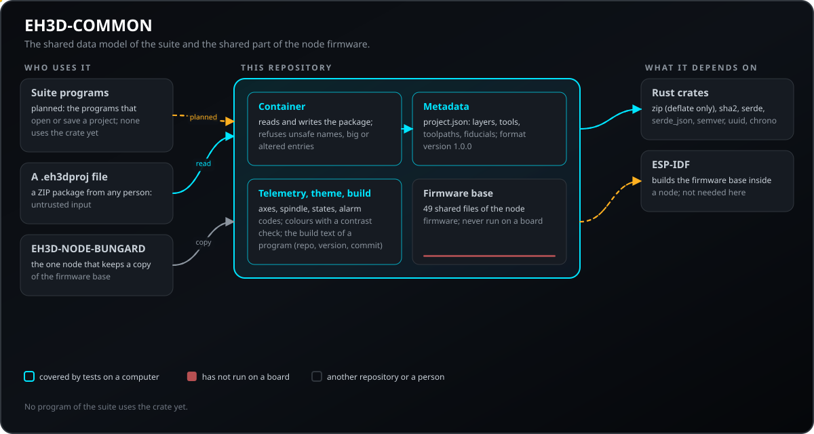
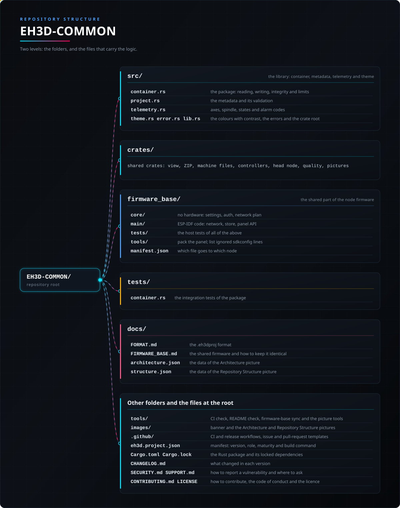

<p align="center">
  
</p>

# 🧱 EH3D-COMMON

<p align="center"><a href="README.md">🇺🇸 English</a> | <a href="README_spa.md">🇪🇸 Español</a> | <a href="README_fra.md">🇫🇷 Français</a> | <a href="README_ita.md">🇮🇹 Italiano</a> | <a href="README_deu.md">🇩🇪 Deutsch</a> | 🇨🇳 <b>中文</b> | <a href="README_jpn.md">🇯🇵 日本語</a> | <a href="README_por.md">🇵🇹 Português</a></p>

### EH3D Fabrication Suite 的共享数据模型：项目容器、元数据、完整性检查和机床遥测

<p align="center">
  
  
  
  
  
</p>

---

**诚实性核对 - 今天真正能运行的内容：** 一个 Rust 库，包含项目容器（`.eh3dproj`）、项目元数据、SHA-256 完整性检查、机床遥测类型和套件的配色，另有套件中每个 ESP32 节点都会复制的固件基础（71 个文件和保持副本一致的工具）。1144 个测试在计算机上运行。钻孔和铣削程序以及现代界面用共享 crate 读取文件并绘制作业；这里的内容也从未在机床或电路板上运行过。

---

> **安全（safety）与信息安全现状：** 该库不是安全系统（safety），也从未用它控制过任何机床。容器能发现因意外而损坏或被改动的包，但它没有签名也没有加密：无法证明项目是谁写的。他人提供的包属于不可信输入，因此对条目名称、大小和数量都设有限制。

## 📋 速览

| | |
|---|---|
| 版本 | `0.3.3` |
| 成熟度 | 脚手架 |
| 测试 | 1144 |
| 技术栈 | Rust（库 crate）和 C++17（固件基础） |
| 真实硬件 | 不适用：这是数据库，不与机床通信；固件基础从未在电路板上运行 |

**跳转到：** [概述](#-概述) · [架构](#-架构) · [快速开始](#-快速开始) · [测试](#-测试) · [结构](#-仓库结构) · [相关项目](#-相关项目)

## 🚦 项目状态

每一行是本仓库的一个部分，灯号表示它今天做到了哪一步。内容依据仓库能够展示的证据（测试、构建、运行），而不是计划。

🟢 已完成并验证 · 🟡 可用，有已知限制 · 🟠 部分完成或尚未验证 · 🔴 未完成或不可用

| 领域 | 状态 | 在这里的含义 |
|---|---|---|
| 容器 | 🟡 | `.eh3dproj` 是标准 ZIP，带有每个条目的 SHA-256 记录；能读写，并拒绝损坏、被改动、未登记和不安全的条目。目前只有它自己的测试在读写。 |
| 元数据 | 🟡 | 项目元数据（单位、零点、图层、刀具、刀路、基准点）会被校验，并带有语义化的格式版本；因为 1.0.0 是第一个格式，所以暂时没有迁移。 |
| 遥测与主题 | 🟡 | 轴、主轴、机床状态、带严重程度的 GRBL 报警码，以及带对比度检查的套件配色，均已测试。 |
| 测试 | 🟡 | 1144 个测试通过（`cargo test --workspace`）：主 crate 的模块内 26 个、容器 34 个，二十二个共享 crate 中 1084 个。 |
| 安全 | 🟡 | 不安全的名称、过大或过多的条目以及任何被改动的条目都会被拒绝；包没有签名也没有加密，也未经独立审查。 |
| 固件基础 | 🟠 | 由 `tools/sync_firmware_base.py` 保持一致的 95 个文件：ESP32 节点 EH3D-NODE-BUNGARD 和 EH3D-NODE-BUNGARD-AUX 共享 50 个（其中 48 个两者都用；只在计算机上通过这两个节点的主机测试测过），两块触摸屏 EH3D-NODE-BUNGARD-HMI 和 EH3D-NODE-HMI-GUI 共享 45 个；从未在电路板上运行。 |
| 被其他程序使用 | 🟡 | 工作区的 crate 已被 EH3D-DRILLPRO、EH3D-ROUTEPRO、EH3D-BUNGARD-GUI、EH3D-PHOENIX-CNC 和 EH3D-SERVER 使用（通过路径，仓库并排放置）；项目容器本身还没有任何程序使用。 |
| 文档 | 🟡 | 八种语言的 README、格式说明和固件基础指南；CI 会将它们与清单和变更日志对照。 |

## 🎯 概述

* **项目容器**：`.eh3dproj` 包是一个标准 ZIP 压缩包，含有 `project.json`、`integrity.json` 以及文件夹 `layers/`、`toolpaths/` 和 `vision/`。写入是确定性的（相同内容得到相同字节），并通过临时文件完成。
* 项目的**元数据**：名称、标识、单位、工件零点、图层、刀具、刀路和基准点，带有语义化的格式版本（目前为 1.0.0）。更新的主版本会被拒绝，而不是只理解一半；更旧的版本需要已注册的迁移，目前还没有。
* **完整性记录**：每个条目的 SHA-256 和大小。条目被改动、缺失或未登记的包无法打开。
* **限制**：可能跳出包文件夹的条目名称会被拒绝，过大或过多的条目也会被拒绝。
* **遥测类型**：轴、主轴、从状态字读取的机床状态，以及带严重程度（警告或严重；未知代码按严重处理）的九个 GRBL 报警码。
* **构建文本**：程序携带的小型 JSON，说明正在运行的是哪个构建（仓库、版本、提交和类型），带有严格的读取器和代码 `EH3D-BUILD-001` 至 `EH3D-BUILD-008`（[docs/BUILD.md](docs/BUILD.md)）。
* **主题**：套件的配色，测试会对每种文字色和状态色做 WCAG 对比度检查。
* **节点的固件基础**（`firmware_base/` 和 `tools/sync_firmware_base.py`）：每个 EH3D 节点共享的 ESP32 节点固件部分（设置文档、网络、面板的服务器、用户与会话、可回滚的更新、日志、自我保护以及配套测试），以项目名称为占位符只写一份。每个节点保留自己的副本并独立编译；工具会把基础写入每个节点，并在副本出现偏差时报告。
* 工作区的**共享 crate**：`eh3d-view`（工作台上的作业、十一种主题、8 种语言的界面文字）、`eh3d-archive`（ZIP 压缩包中的作业）、`eh3d-bungard-formats`（Excellon、HP-GL、刀具表和配置文件，Gerber 和 DXF 轮廓）、`eh3d-controller`（机床控制器接口，GRBL、Marlin 和 Klipper（可读取其最大行程），以及用来测试它们的模拟机床，附带按种子破坏消息的线缆）、`eh3d-filedialog`（打开和保存窗口）和 `eh3d-fleet`（服务器的机床和工位）和 `eh3d-serverclient`（服务器的唯一客户端：登录与续期、按代码给出八种语言的错误、重试、连接状态、服务器不在时等待的请求队列、能发现已撤销路由的契约缓存、连接指标、请求头和字节正文以及项目存储的标签规则（`ETag`、`If-Match`、428 与 412 拒绝），以及默认关闭的可选 mDNS 搜索；其设置面板、会话列表和连接徽标位于 `eh3d-view`），以及 `eh3d-dock`（专业窗口的框架：可停靠、浮动、折叠和锁定的面板，命名工作区，以数据声明的菜单栏和快捷键，支持八种语言；用 egui 绘制是功能 `gui`；指南见 [docs/DOCKING.md](docs/DOCKING.md)）。借助它，PHOENIX 系列的程序把自己的颜色用在窗口的强调部分，并把最近的项目保存在用户文件夹中。
* **机器的标准视图:** `eh3d_view::views` 从上方（真正的平面图：X 向右，Y 向上，高度不会移动点）、正面（X 向右，Z 向上）、侧面（Y 向右，Z 向上）以及常用的等轴视图绘制工作台和机器空间，两个屏幕轴使用相同的比例，并可带边距把其中任何一个视图适配到像素区域内的机器包围盒。`Iso` 的投影不变。
* **工作台高度与钻头节点：** `eh3d-levelling` 保存机床工作台的高度图（测量点网格、点间曲面插值、倾斜和高低差、作业 Z 的修正，以及保存高度图的文本形式），`eh3d-aux` 是 EH3D-NODE-BUNGARD-AUX 的客户端（其状态、对工作台的测量、MJPEG 摄像头、带令牌的请求和一个小型 HTTP 客户端）。

## 🧩 在 EH3D 中的角色

EH3D-COMMON 是套件的基础。其工作区的 crate（视图和主题、ZIP 压缩包、Bungard 机床的文件、机床控制器、文件窗口和服务器的机群）如今被 EH3D-DRILLPRO、EH3D-ROUTEPRO、EH3D-BUNGARD-GUI、EH3D-PHOENIX-CNC 和 EH3D-SERVER 使用；打开或保存项目的库和程序计划依赖该容器，目前还没有一个存在。节点的固件基础也在这里：EH3D-NODE-BUNGARD 是第一个使用它的节点。

## 🏛️ 架构

<p align="center">
  
</p>

本仓库各部分如何协作：谁在使用它、它包含什么、它依赖什么。图片由 `docs/architecture.json` 绘制，并与代码核对。

## ✨ 功能

* **确定性的原子写入：** 相同项目总是得到相同字节，文件通过临时文件写入，所以写入失败不会留下半个包。
* **读取时全部检查：** 先检查名称、数量和大小，再用完整性记录核对每个条目，最后检查元数据；第一个问题就以带类型的错误中止读取。
* **任何工具都能打开的格式：** 普通 ZIP（仅 deflate）和普通 JSON，无需本 crate 即可阅读；`docs/FORMAT.md` 是成文的约定。
* **读取方保持兼容：** 同一主版本会忽略未知内容继续读取；更新的主版本会被拒绝。
* **不会丢失的报警码：** 本 crate 不认识的代码保存为 `Unknown(n)`，并按严重处理。
* **所有节点共用一套固件基础：** 在发现需求的地方修改，`import` 后再用 `sync` 写入其他节点，CI 中的 `check` 会在副本偏离时报告。
* **质量分析器和钻头的 LED 环形灯：** `eh3d-inspect` 根据一组公差配置判断钻头摄像头拍到的图像（孔是否存在、是否圆、尺寸是否正确、位置是否准确；铣削沟槽是否与刀具一样宽、是否均匀、有无变窄；图像是否足够清晰可判断），并给出合格、不合格或无法判定。`eh3d-aux` 还可打开和关闭摄像头周围的 LED 环形灯、用颜色显示检查结果、拍摄图像并把配置交给服务器。
* **新格式的诊断与容器：** `eh3d-diagnostic` 是每个读取器共用的结果（稳定代码、严重程度、消息、发生位置、JSON 形式和脱敏形式）。`eh3d-container` 保存所有项目容器共享的内容：格式参数、完整性记录、规范 JSON、带有 `EH3D-PKG-001` 至 `EH3D-PKG-024` 代码的严格名称与 ZIP 策略、有界的流式读取器、确定性的流式写入器，以及目标文件的原子替换（在 Windows 上若其他程序占用文件会短暂重试）。此 crate 的 `.eh3dproj` 1.0.0 代码保持不变。文件夹 `crates/auxnode` 即软件包 `eh3d-aux`。
* **带分支的项目容器（`eh3d-project`）：** 一个 `.eh3d` 文件，每个程序一个分支（`pcb/`、`cad/`、`3dp/`、`laser/`、`cnc/` 等），`common/` 放可选的元数据，`docs/` 放八种语言的文档，`manufacturing/` 保存一个 `.eh3dproj` 1.0.0 包并按字节原样还给它。每个程序只写自己的分支，其他分支的字节永不改变；由另一个分支派生的分支会在其来源改变时被发现；未知的分支原样保留。代码 `EH3D-PKG-015` 至 `EH3D-PKG-024` 属于它。分支和整个项目可以用 Ed25519（`ed25519-dalek`）签名：密钥是项目之外的文件，从不打印，也从不存入项目；打开文件时会说明每个签名是已签名且有效、未签名还是无效。封印有各自的记录和检查；分支加密尚待完成（见 `docs/adr/0002-eh3d-project-container.md`）。每个程序对自己分支所做的事（保存、打开、带报告导入、从其他分支取用、过期提示）由模块 `appbranch` 共享。格式见 `docs/FORMAT_EH3D.md`，命令 `eh3d-project info|verify|extract-branch|keygen|sign` 可查看文件内部。根据作业生成内容的程序（查看器、钢网、隔离铣、钻孔、铣外形）通过模块 `manufacturing` 读取作业并保存结果；各窗口共享写入前显示的内容（`suiteview`，八种语言的文字在 `suitetext`）。
* **项目附件：** 任何文件（数据手册、说明书、办公文档、工程与图纸、视频、音频或其他）都可以放进 `.eh3d`，内容只存一份，并关联到使用它的设计元件（位号、数值或厂商型号），也可以只保存带地址和哈希的链接。程序、脚本、带宏的文档、压缩包以及可运行代码的页面会标记为危险，只有在人员同意后才能取出；不会运行或下载任何内容。每个附件最大 1 GB（可配置），整个项目 4 GB。命令为 `eh3d-project attach`、`attachments`、`extract-attachment` 和 `detach`；格式见 `docs/FORMAT_EH3D.md` 和 `docs/adr/0003-eh3d-attachments.md`。各程序的窗口目前还不显示附件。
* **图像读取器：** `eh3d-image` 将 PGM 和 PNG 文件读成灰度（灰度、彩色、调色板或透明，8 位或 16 位，透明按白色计），并限制尺寸，使恶意文件无法索取数 GB 内存；它用盒式滤波缩放图像，并可在图像上画圆盘。激光雕刻和基准点查找都使用它，而不是各自保留一份副本。
* **作业开始前的检查：** `eh3d-summary` 在纸面上按计划的精确步骤走一遍（每个轴的步进位和方向位，以及吞掉越界步数的限位开关），得知每个轴走到哪里、作业要多久，在电机转动之前就找出超出机床行程的计划，用来自机床调校的阈值做作业的合理性检查（单位错误、作业比工作台大或离角落太远、比例不为 1），并用 8 种语言说明这一切。钻孔程序、铣削程序、现代界面和服务器显示同一份摘要。
* **电路板材料数据库:** `eh3d-materials` 保存层压板、半固化片、柔性板、金属基板和 PTFE 板,数值均为各厂商所公布(每条记录注明其数据手册,手册未给出的值保持为空);加载时进行检查(唯一标识符、可信的 Dk、Df、Tg 和 Td),可按标识符、厂商、类型以及最低 Tg、Dk、Df 查询,在已公布的频率之间对 Dk 和 Df 进行插值且从不外推,提供机床程序所需的精简视图,并按用途(钻孔和铣削电路板的 CNC,或设计工具)对参考文档分类。数据手册仅以下限给出的玻璃化转变温度(“高于 280 C”)与实测值分开保存。同一个 crate 还有第二个系列,用于 CNC 雕刻机或激光加工的材料(55 种木材、塑料、金属、电路板板材、纸、皮革、织物、橡胶、泡沫和玻璃,名称含八种语言):它说明激光对每种材料能做什么、不能做什么及其原因(PVC、ABS、聚碳酸酯、乙烯基、碳纤维等会连同背后的危险一并被拒绝),并给出雕刻机和激光的起始值,这些值只在已知点之间插值,从不外推,也从不标记为已验证;指南见 [docs/MACHINING.md](docs/MACHINING.md)。其错误代码为 `EH3D-MAT-001` 至 `EH3D-MAT-015`。
* **3D 打印材料数据库：** `eh3d-printmaterials` 保存 FDM 耗材和光敏树脂（SLA、DLP、LCD、MSLA），数值均为各厂商所公布（每条记录注明来源，说明未在机器上试过，且不含价格）。加载时进行检查，可按材料、喷嘴、热床、填充物和打印机查询，给出每米重量、干燥要求以及耗材所需的硬化喷嘴，并按打印机和层高给出树脂的曝光参数，仅在已知点之间插值、绝不外推，警告提供八种语言。约 475 种耗材的初始数据部分来自采用 MIT 许可的开放数据库（声明附在该 crate 中）。其错误码为 `EH3D-PMAT-001` 至 `EH3D-PMAT-009`；指南见 [docs/FILAMENTS.md](docs/FILAMENTS.md)。
* **3D 打印机目录：** `eh3d-printers` 按机型保存打印体积、喷嘴、是否封闭、最高温度、多色系统、与之通信的程序类别以及支持的文件，每项数据都附有厂商的公开页面，且均未在机器上验证（目前为 Bambu Lab A1 和 P1S、两款 Creality 和两款 Artillery）。它从材料数据库给出起步耗材（无法打印的附原因），并按喷嘴计算起步工艺，提供八种语言；指南见 [docs/PRINTERS.md](docs/PRINTERS.md)。
* **附件查看器：** `eh3d-viewer` 在程序内部显示项目的数据手册、说明书和其他文件：可缩放和搜索的 PDF 页面（不含脚本引擎的 PDFium，版本和 SHA-256 均固定，且只从程序所在文件夹加载）、图片、文本、Markdown，以及办公文档的文字和表格。程序、脚本、含宏的文件和压缩包会显示警告，在任何内容离开程序之前先询问；程序和脚本绝不会被启动。面板位于 `gui` 特性中，文字提供八种语言，各程序通过下面的附件面板显示它；指南见 [docs/VIEWER.md](docs/VIEWER.md)。
* **唯一的文件分类与“附件”面板：** 附件是什么文件、是否危险、在磁盘上可以用什么名称，只由 `eh3d-filekind` 判断；程序、脚本、含宏的文件、压缩包、HTML、SVG，**以及套件无法识别的类型**，在提取或打开之前都要求确认。`eh3d-attachpanel` 是 PHOENIX 程序用几行代码即可装入的面板：项目附件列表、添加文件或链接、关联到元件、先询问再提取和移除，旁边是查看器，支持八种语言；含有服务器令牌的设置文件不会放入项目。指南见 [docs/ATTACHMENTS_PANEL.md](docs/ATTACHMENTS_PANEL.md)。
* **8 种语言：** 共享界面（`eh3d-view`）的文字提供英语、西班牙语、意大利语、德语、法语、葡萄牙语（葡萄牙）、中文和日语。代码 `pt-br` 按葡萄牙语读取，`fr-ca` 按法语读取；其他语言的代码一律视为未知，程序保持原有的语言。

## 🔒 安全与防护

容器会读取他人可能发来的文件，因此下面每项检查都是对恶意或损坏的包的防御，并且每项都有测试。

| 威胁 | 防御 |
|---|---|
| 跳出包文件夹的名称（`../x`、`/etc/x`、`C:\x`） | `check_entry_name` 拒绝空的、绝对的或过长（超过 240 字节）的名称、反斜杠、冒号、控制字符，以及任何空的、`.` 或 `..` 部分；写入时检查，读取 ZIP 中的每个名称时再检查一次 |
| zip 炸弹，或条目数量极多的包 | 最多 10,000 个条目，每个条目 256 MiB，总计 1 GiB；读取一个条目时超出上限 1 字节就会停止 |
| 条目在途中被改动（无意或有意） | 将每个条目的 SHA-256 和大小与 `integrity.json` 比较；不同、缺失或未登记的条目会使整个包被拒绝 |
| 两个同名条目 | 读取时作为重复被拒绝；写入时被替换的条目只保留一份 |
| 来自更新程序的包 | 更新的主格式版本会被拒绝，而不是只理解一半 |
| 元数据不一致（名称为空、刀具 id 重复、NaN、负直径、`layers/` 之外的图层） | `validate` 在写入前和读取后运行；无效的项目无法写入 |
| 无 unsafe 代码 | 该 crate 为 `#![forbid(unsafe_code)]` |

**没有防御的内容：** 包没有签名也没有加密。能重写条目的人也能重写完整性记录，所以它能发现损坏和意外，而不能证明作者。该库未经独立审查。请私下报告漏洞（见 [SECURITY.md](SECURITY.md)）。

## 🔌 接口

| 接口 | 内容 | 位置 |
|---|---|---|
| Rust API | `Package`（`new`、`add_entry`、`entry`、`entry_names`、`integrity`、`write`、`write_to_path`、`to_bytes`、`read`、`read_from_path`）、`ProjectMetadata`（`new`、`validate`、`to_json`、`read_metadata`）、遥测类型和 `theme`, `build` | `src/` |
| 文件格式 | `.eh3dproj`：含 `project.json`、`integrity.json` 和数据文件夹 `layers/`、`toolpaths/`、`vision/` 的 ZIP | [docs/FORMAT.md](docs/FORMAT.md) |
| 错误 | 一个 `Error` 枚举：`Io`、`Json`、`Zip`、`UnsupportedFormat`、`MissingEntry`、`Integrity`、`UnsafePath`、`DuplicateEntry`、`TooLarge`、`InvalidMetadata` | `src/error.rs` |
| 固件基础工具 | `python tools/sync_firmware_base.py check`、`sync`、`import <节点>` 和 `status` | [docs/FIRMWARE_BASE.md](docs/FIRMWARE_BASE.md) |

本仓库没有命令行程序、服务器，也没有网络访问。

## ⚙️ 配置

该库没有配置文件：它的限制是代码中的常量，列在这里是为了让读者知道一个包可以包含什么。格式版本是文件的一部分，而不是设置。

| 值 | 限制 | 位置 |
|---|---|---|
| 一个包中的条目数 | 1 到 10,000 | `src/container.rs` 中的 `MAX_ENTRIES` |
| 单个条目的大小 | 最大 256 MiB（268,435,456 字节） | `MAX_ENTRY_BYTES` |
| 所有条目的总大小 | 最大 1 GiB | `MAX_TOTAL_BYTES` |
| 条目名称的长度 | 1 到 240 字节 | `check_entry_name` |
| 数据文件夹 | 仅 `layers/`、`toolpaths/`、`vision/` | `src/project.rs` 中的 `DATA_FOLDERS` |
| 格式版本 | 1.0.0（读取相同主版本，拒绝更新的主版本） | `FORMAT_VERSION` |
| 刀具直径 | 有限且大于 0 | `ProjectMetadata::validate` |

固件基础有自己的设置文档（`node_settings.hpp`、`config_common.hpp`）；其值属于各个节点，在 EH3D-NODE-BUNGARD 的 README 中说明。

## 🚀 快速开始

需要稳定版 Rust 工具链（1.89 或更高）。

```rust
use eh3d_common::{Package, ProjectMetadata};

fn main() -> eh3d_common::Result<()> {
    let mut package = Package::new(ProjectMetadata::new("Test board"));
    package.add_entry("layers/top.gbr", b"G04 test*".to_vec())?;
    package.write_to_path(std::path::Path::new("board.eh3dproj"))?;
    let again = Package::read_from_path(std::path::Path::new("board.eh3dproj"))?;   // 检查每个条目
    println!("{} data entries", again.entry_names().count());
    Ok(())
}
```

```bash
cargo build --release
cargo test
cargo clippy --all-targets -- -D warnings
cargo fmt --check
python -I tools/ci_validate.py
python -I tools/sync_firmware_base.py check
```

## 🧪 测试

测试共 1144 个（`cargo test --workspace`，CI 中在 Windows 和 Linux 上运行）：模块内 26 个（元数据及其校验、报警码和机床状态、配色及其 WCAG 对比度、构建文本（格式、拒绝和代码）），容器 34 个（其中 14 个记录该格式目前的行为：条目顺序、精确的 JSON、ZIP 标志位以及对 19 个损坏包的判定；其余涵盖内存和文件的往返、相同内容得到相同字节、完整性记录、被改动的条目、被改动的大小、未登记的条目、缺失的条目、被编辑的元数据、不是包的文件、不安全和恶意的条目名称、被替换的条目、无效的项目，以及格式描述与代码的比较）。CI 还运行 `cargo fmt --check`、将警告视为错误的 `cargo clippy`、`python -I tools/ci_validate.py`（清单、版本、变更日志和八个 README）以及 `tools/sync_firmware_base.py check`（固件基础的副本）。固件基础的主机测试（`firmware_base/tests/`）在 EH3D-NODE-BUNGARD 中运行，而不在这里。二十个共享 crate 另有 1068 个：作业压缩包（8 个）、Bungard 机器的文件及 HP-GL 圆弧、圆和缩放以及 Gerber 和 DXF 轮廓（61 个）、在模拟线路上的机器控制器（141 个）、场景、视图、主题以及八种语言的界面文字（87 个）、打开和保存窗口（7 个）、服务器的机床和工位（8 个）以及工作台高度图（11 个）钻头节点的客户端（含 LED 环形灯和图像，10 个）、PGM 和 PNG 图像读取器（7 个）、作业前的空运行和摘要（23 个）以及质量分析器（43 个）：孔、铣削沟槽、图像质量、配置和结论，以及容器格式共享的部分：完整性记录、内容哈希、名称规则和规范 JSON，以及带严格策略的通用读取器和写入器、`EH3D-PKG` 代码和原子替换（71 个），带分支的 `.eh3d` 项目容器：记录、引用、权限、封印、签名、损坏的文件、附件和命令行（83 个），以及服务器客户端：登录与续期、按代码的拒绝及其八种语言文本、间隔递增的重试、连接状态和绝不打印的令牌（170 个），以及停靠框架：布局及其修复、拖动的几何、文本形式和工作区、快捷键和菜单、各领域的方案以及用 egui 绘制（128 个，其中 14 个需要功能 `gui`）。通用诊断（6 个）、材料数据库（电路板和加工，104 个）和 3D 打印材料数据库（38 个）也计入同一总数。3D 打印机目录另有 22 个。附件查看器有 57 个测试（其中 2 个启用 `gui` 特性，3 个使用真实的 PDF 库）。唯一文件分类有 9 个测试，附件面板有 11 个。

## 🏗️ 构建与发布

版本号位于 `Cargo.toml` 和 `eh3d.project.json`，每个版本在 [CHANGELOG.md](CHANGELOG.md) 中都有条目。版本发布在 GitHub 上；该库以本仓库的 Rust crate 形式使用，不在 crates.io 上。

## 📂 仓库结构

<p align="center">
  
</p>

<details>
<summary>目录树的文本版</summary>

```text
EH3D-COMMON/
├── src/
│   ├── container.rs                             包：读写、完整性和限制
│   ├── project.rs                               元数据及其校验
│   ├── telemetry.rs                             轴、主轴、状态和报警码
│   ├── build.rs                                 当前运行的构建：仓库、版本、提交和类型，以小型 JSON 表示
│   └── theme.rs error.rs lib.rs                 带对比度的配色、错误和 crate 根
├── crates/                                      共享 crate：视图、ZIP、机器文件、控制器、钻头节点、质量分析、图像、摘要
├── firmware_base/
│   ├── core/                                    无硬件：设置、认证、网络方案
│   ├── main/                                    ESP-IDF 代码：网络、存储、面板 API
│   ├── tests/                                   以上全部的主机测试
│   ├── tools/                                   打包面板；列出被忽略的 sdkconfig 行
│   └── manifest.json                            哪个文件进入哪个节点
├── tests/                                       包：往返、被改动、缺失和未登记的条目、不安全的名称
├── examples/                                    如何使用共享的构建文本
├── docs/                                        格式、固件基础和两张图的数据
├── tools/                                       CI 和 README 检查、固件基础同步及绘图工具
├── images/                                      横幅图以及架构和仓库结构图片
├── .github/                                     CI 与发布工作流、Issue 和 PR 模板
├── eh3d.project.json                            清单：版本、角色、成熟度和构建命令
├── Cargo.toml Cargo.lock                        Rust 包及其锁定的依赖
├── rust-toolchain.toml                          固定的 Rust 工具链
├── CHANGELOG.md                                 每个版本的变更
├── SECURITY.md SUPPORT.md                       如何报告漏洞及在哪里提问
└── CONTRIBUTING.md CODE_OF_CONDUCT.md LICENSE   参与贡献、行为准则和许可证
```

</details>

## 🗺️ 路线图与已知限制

**目前已知的限制**

* 还没有程序使用项目容器，所以这个格式只被它自己的测试读写过。
* 包没有签名也没有加密，该库也未经独立审查。
* 因为 1.0.0 是第一个格式，所以没有迁移。
* 固件基础只通过 EH3D-NODE-BUNGARD 验证过，从未在电路板上运行；还没有第二个节点。
* 该库没有发布到 crates.io。

**下一步**

* 让套件的第一个程序用它打开和保存项目（先从 EH3D-CORE-LIBS 开始）。
* 把第二个节点加入固件基础，并检查副本保持一致。
* 决定包是否需要可选的签名。

## 🌍 语言

README 和文本提供英语、西班牙语、法语、意大利语、德语、汉语、日语和欧洲葡萄牙语版本。

## 🔗 相关项目

* [EH3D-CORE-LIBS](https://github.com/JuanenRac/EH3D-CORE-LIBS)：解析器（Excellon、Gerber、G 代码）、栅格、几何和 CAM 库，以及 Gerber 和 Excellon 写入器
* [EH3D-NODE-BUNGARD](https://github.com/JuanenRac/EH3D-NODE-BUNGARD)：第一个保存固件基础副本的节点
* [EH3D-SERVER](https://github.com/JuanenRac/EH3D-SERVER)：家族的中心；它使用本仓库的摘要、检查和诊断 crate，目前还不使用项目容器
* [EH3D-PHOENIX-PCB](https://github.com/JuanenRac/EH3D-PHOENIX-PCB)：家族的设计工具，其同伴为 [EH3D-VALIDATION-LAB](https://github.com/JuanenRac/EH3D-VALIDATION-LAB) 和 [EH3D-PHOENIX-CAD](https://github.com/JuanenRac/EH3D-PHOENIX-CAD)；它在 `eh3d-container` 之上构建自己的项目格式，并用 `eh3d-diagnostic` 报告每一种失败
* [EH3D-DOCS](https://github.com/JuanenRac/EH3D-DOCS)：套件的文档中心及其项目地图
* [HYDRA-UMC](https://github.com/JuanenRac/HYDRA-UMC)：套件未来要驱动其机器的机器人平台

## 📚 文档

* [项目格式](docs/FORMAT.md)：条目、元数据、完整性记录以及对读取方的规则。
* [固件基础](docs/FIRMWARE_BASE.md)：共享什么、如何保持一致以及如何添加节点。
* [变更日志](CHANGELOG.md)
* [使用这些 crate](docs/CONSUMING.md)：相邻文件夹、路径和版本行、特性，以及 CI 构建所用的标签。
* [文件读取器的错误](docs/FORMAT_ERRORS.md)：钻孔文件、绘图文件和图纸读取器的稳定错误码，附行号和列号。
* [服务器客户端](docs/SERVER_CLIENT.md)：登录与续期、按代码给出八种语言的错误、重试、连接状态、配置键以及各程序的迁移步骤。
* [构建文本](docs/BUILD.md)：程序携带的、说明自己是哪个构建的小型 JSON，如何嵌入及其代码。
* [机床控制器](docs/CONTROLLERS.md)：所驱动的对象（GRBL、Marlin、通过 HTTP 的 Klipper）、无需连接任何设备即可试验的模拟机床和带故障的线缆、错误编号，以及各控制器如何在机床失去响应时将其停止。

## 🤝 参与贡献与社区

* 提交 pull request 之前请运行 `cargo fmt --check`、`cargo clippy --all-targets -- -D warnings`、`cargo test`、`python -I tools/ci_validate.py` 和 `python -I tools/sync_firmware_base.py check`，全部通过。参见 [CONTRIBUTING.md](CONTRIBUTING.md) 和[行为准则](CODE_OF_CONDUCT.md)。
* README 有八种语言：修改文字时要同步修改全部八个文件，两张图片由 `tools/make_architecture.py` 和 `tools/make_structure.py` 根据 `docs/architecture.json` 和 `docs/structure.json` 绘制。
* 对固件基础的修改应在某个节点中进行，用 `tools/sync_firmware_base.py import` 导入，再同步到其他节点；不要手工编辑任何一个副本。
* 请私下报告漏洞：[SECURITY.md](SECURITY.md)。问题、想法和报告：electrohobby3d@gmail.com（[SUPPORT.md](SUPPORT.md)）。

## 👤 作者

**JuanenRac (Electro Hobby 3D)** · electrohobby3d@gmail.com

## 📜 许可证

软件：GPL-3.0-or-later。见 [LICENSE](LICENSE)。套件的硬件设计使用 CERN OHL-S。
